# 律智检

> 面向企业法务与律师团队的法律文书、合同审查与知识检索工作台。

律智检把法律咨询、合同风险审查、文书草稿、法规与案例检索、律师审核，以及受控的 Agent 执行收敛到同一条工作流里。案件是工作的容器：材料上传后经过安全检查、解析、切分与索引，产出带页码和原文摘录的引用；AI 结论与律师的最终决定分开留痕，写入型操作按策略要求人工审批。

项目面向真实业务资料设计：法律敏感字段独立加密，LLM 出站统一经过数据分级与脱敏，检索、工具调用和 Agent 决策均可审计回放。它既可以作为一个可运行的演示环境，也适合作为 AI 工程化项目来展示模块化单体设计、RAG 集成、Agent 治理和前后端协作能力。

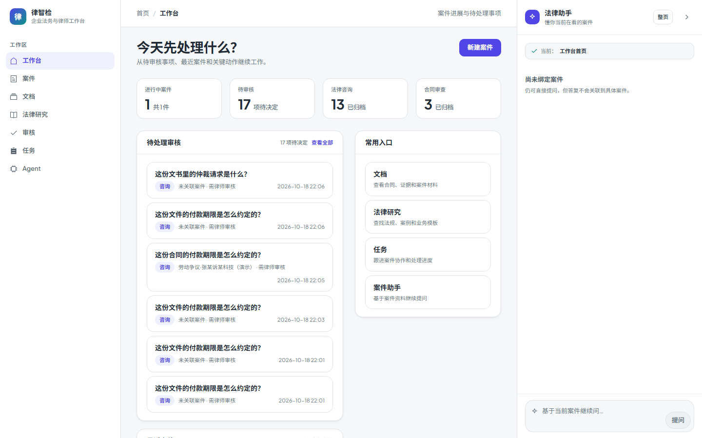

## 目录

- [功能概览](#功能概览)
- [界面预览](#界面预览)
- [技术栈](#技术栈)
- [架构总览](#架构总览)
- [角色与工作路径](#角色与工作路径)
- [快速开始](#快速开始)
- [核心环境变量](#核心环境变量)
- [演示账号](#演示账号)
- [项目结构](#项目结构)
- [验证](#验证)
- [文档导航](#文档导航)
- [发布说明](#发布说明)
- [截图维护](#截图维护)
- [已知边界](#已知边界)

## 功能概览

- **案件工作区**：概览、文档、法律咨询、合同审查、文书、审核、任务与关键日期共 8 个标签页，共享同一份案件上下文
- **任务中心**：看板/表格双视图，负责人与协作者真实用户、到期提醒（负责人 + 协作者，站内 + 邮件）与逾期 3 天升级 owner、批量改派/完成/归档、评论与操作日志、优先级/范围/逾期筛选与统计卡，写操作按 owner/负责人/协作者权限分层
- **法律咨询**：混合检索（向量 + BM25 + RRF 重排）后给出结构化分析，标注风险级别、引用法条与逐句依据覆盖率
- **合同审查**：版面感知解析 → 条款切分 → 高/中/低风险分级 → 原文定位，可导出审查意见并对比版本差异
- **文书草稿**：按文书类型生成结构化字段（当事人、仲裁请求、事实与理由、证据清单），草稿进入版本管理并可提交审核
- **人工审核**：AI 摘要只作参考，审核队列提供批量分配、证据/法源核对、审核备注与处理时效统计
- **Agent 编排**：总管 Agent 规划，知识、合规、执行三类 Worker 分工，工具调用经 MCP 策略校验，写操作按风险等级进入人工审批
- **治理与可观测**：Trace、结构化审计、提示词版本、模型路由与灰度发布；失败样本经人工脱敏后才进入评测集与回归门禁
- **数据出站保护**：出站 LLM 调用统一分级、PII 检测与脱敏，极敏感数据默认阻断，密钥与连接器凭据独立配置

## 界面预览

截图取自本地演示数据（`scripts/seed_demo_data.py`），重新生成方式见[截图维护](#截图维护)。

### 案件工作区

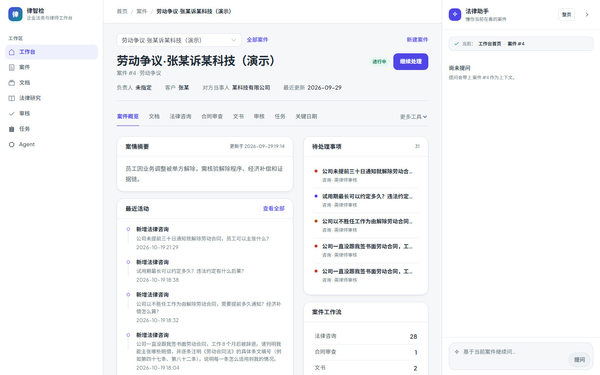

*案情摘要、最近活动、待处理事项，以及贯穿案件的咨询/审查/文书计数。*

### 法律咨询与合同审查

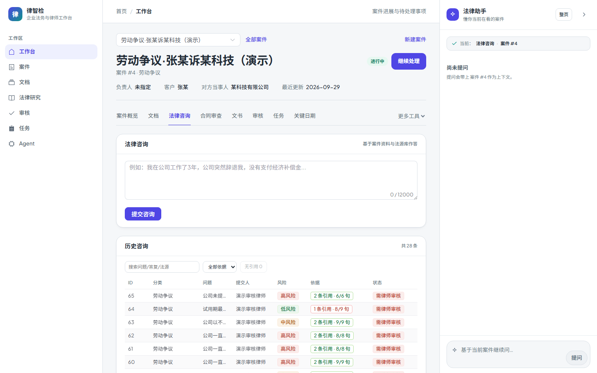

*历史咨询按风险级别、引用条数与依据覆盖率（如 2 条引用 · 6/6 句）标注，并区分「待律师审核」状态。*

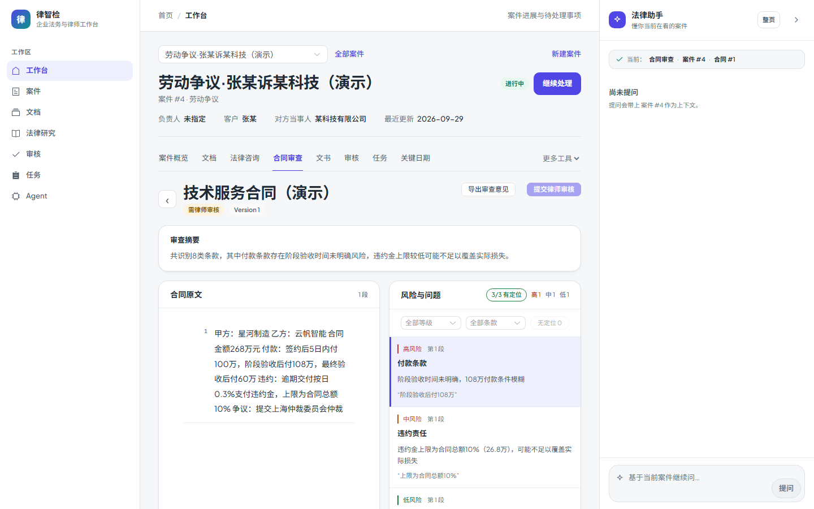

*逐条给出风险等级与原文摘录，3/3 条款可溯源到合同中的具体位置。*

### 文书草稿

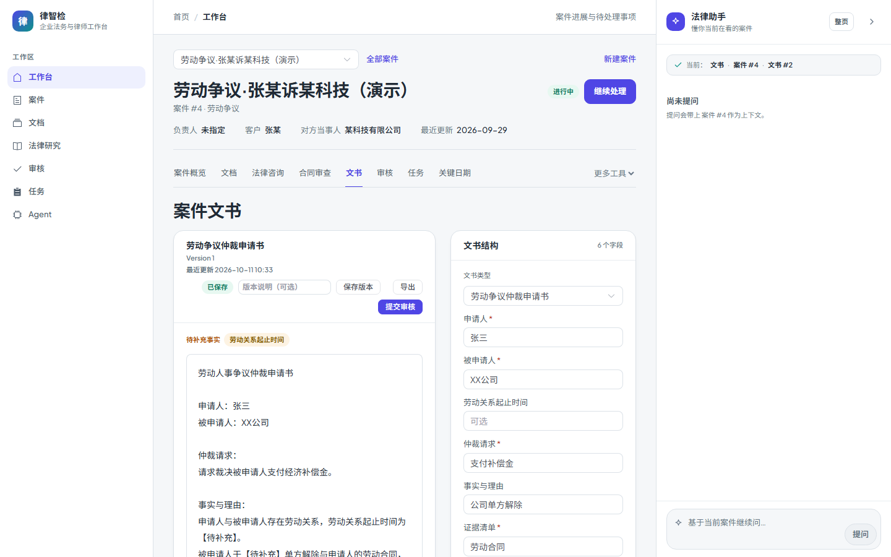

*正文与右侧结构化字段联动，版本、保存与「提交审核」在同一处完成。*

### 人工审核与法律资料

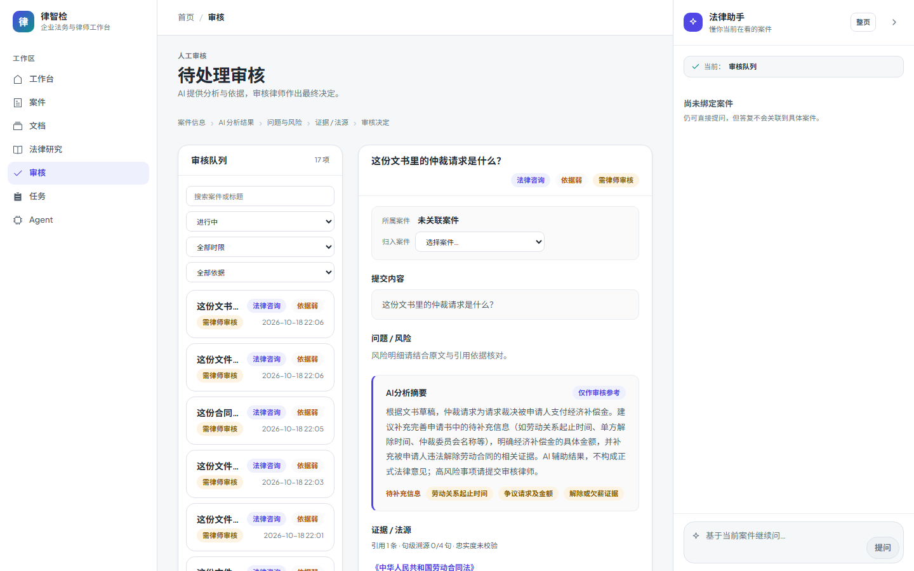

*左侧为待决定事项，右侧是 AI 分析摘要、待补充事实与证据/法源，最终决定权在审核律师。*

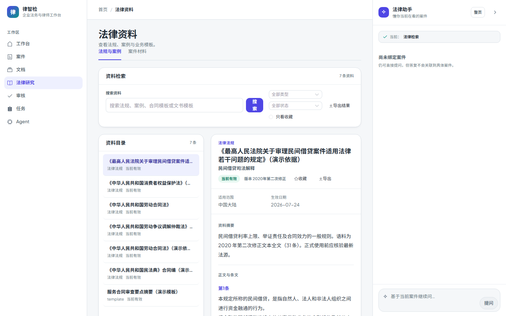

*法规与案例的可检索目录（导航中称「法律研究」），展示有效性、版本与导出能力。*

### Agent 与任务

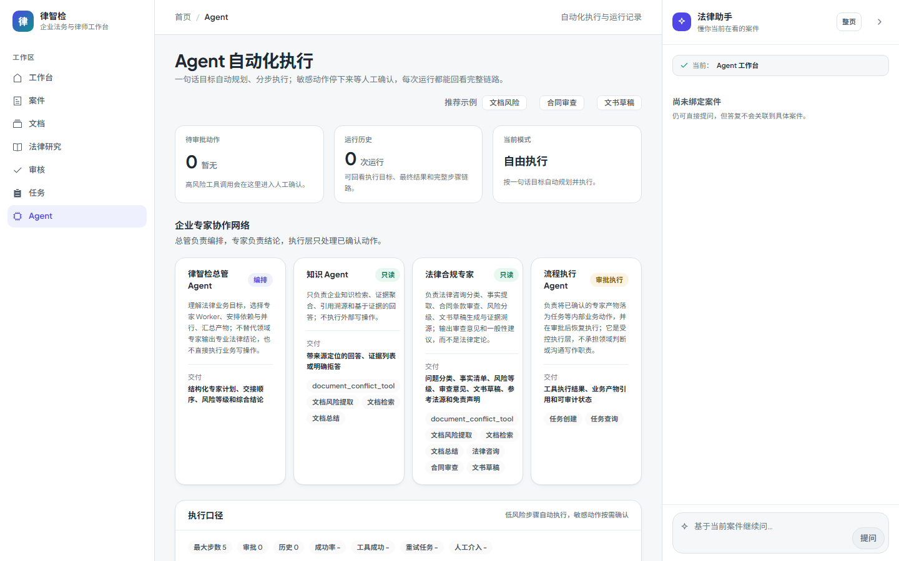

*总管与专业 Agent 的职责边界、可调用工具与执行口径在一屏内说明。*

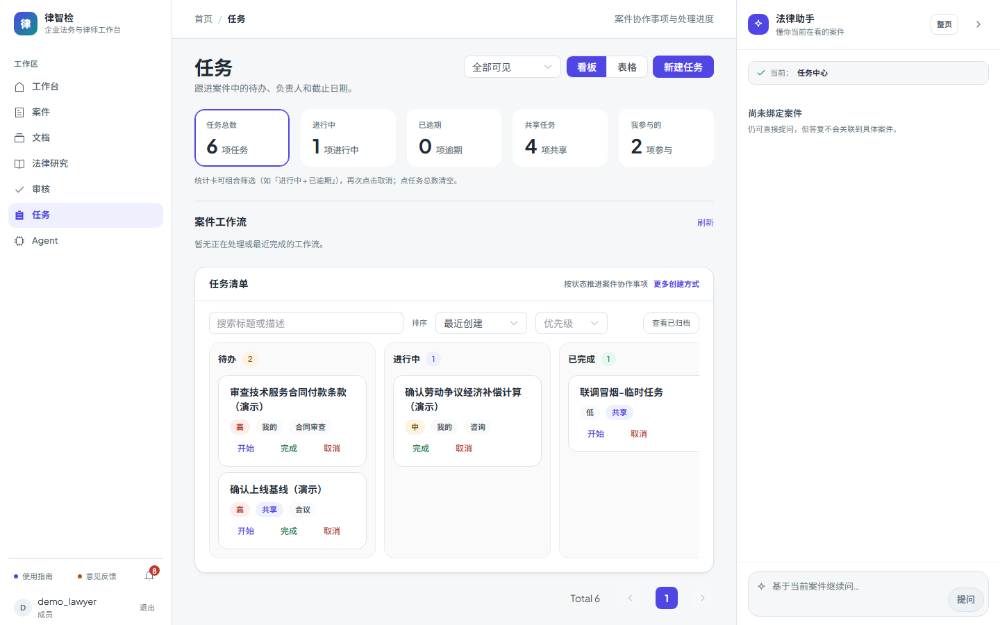

*看板按待办/进行中/已完成推进案件协作事项，顶部五张统计卡可点击组合筛选。*

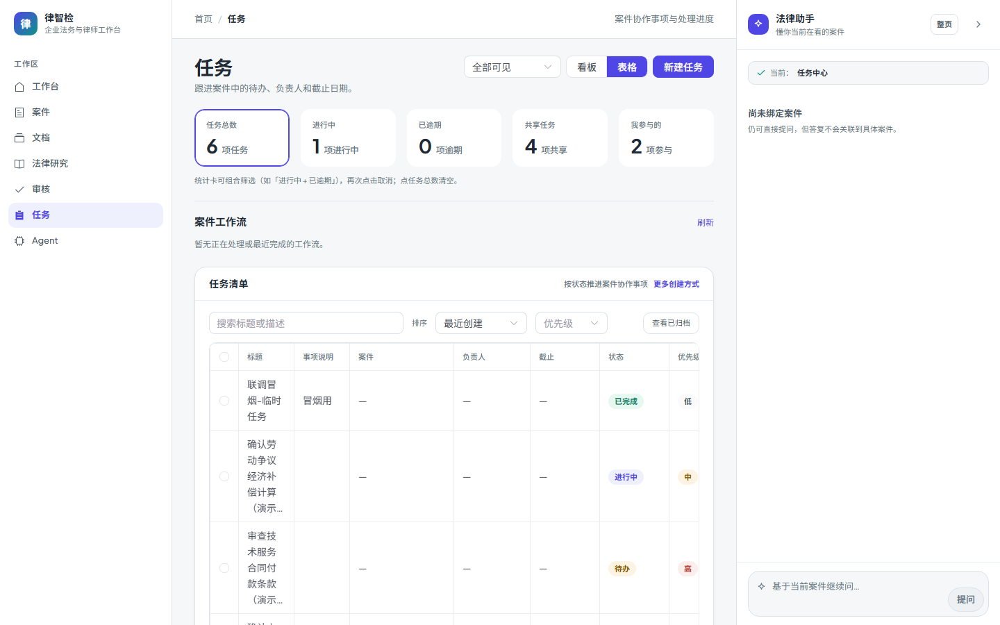

*表格视图展示负责人、优先级、截止日期与范围标签，可多选后批量改派/完成/归档。*

### 治理与运维

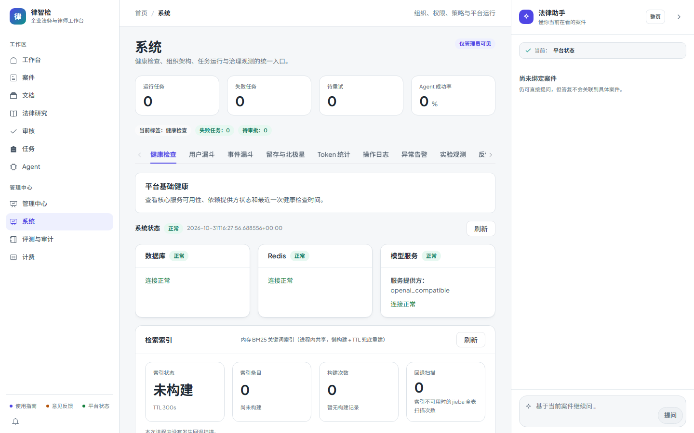

*数据库、Redis、模型服务与检索索引的健康状态统一展示，供运营与排障使用。*

## 技术栈

- **后端**：Python 3.11、FastAPI、SQLAlchemy 2.0、Alembic、Celery
- **数据**：MySQL 8（事务/版本/审计）、Redis 7（缓存/限流/任务协调）、Chroma 或 Qdrant（向量）、SQLite（LangGraph checkpoint）
- **AI 能力**：LangGraph、LangChain、OpenAI 兼容的对话/向量/视觉模型、BM25（jieba + rank_bm25）、MCP 工具协议
- **文档处理**：pdfplumber / PyPDF2 / python-docx / python-pptx / openpyxl、Tesseract OCR、版面与印章/签字区域识别
- **前端**：Vue 3、Vite、Element Plus、Pinia、Vue Router
- **工程配套**：Docker Compose、GitHub Actions（pytest + ruff + 前端构建）、Playwright 端到端测试、OpenTelemetry 与 Sentry

## 架构总览

项目采用模块化单体：Vue 3 提供法律工作台，FastAPI 提供 HTTP/WebSocket API，业务能力按领域纵向切片，域间只通过 service 门面通信。

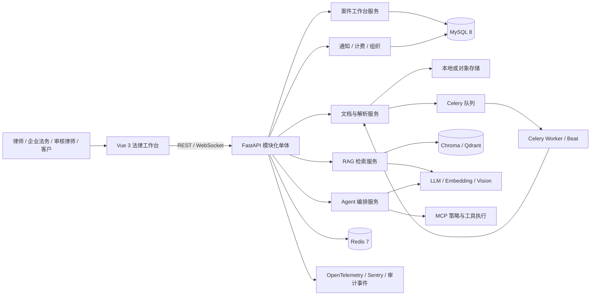

后端只允许 `API → Service → Model/Repository → Core` 的单向依赖；任务层可以调用业务服务，但业务服务不反向依赖任务框架。

详细设计见：

- [系统架构与模块边界](docs/ARCHITECTURE.md)
- [多模态法律文档理解](docs/MULTIMODAL_DOCUMENT_ANALYSIS.md)
- [MCP 策略即代码](docs/MCP_POLICY_AS_CODE.md)
- [Agent 可观测与线上评测](docs/AGENT_OBSERVABILITY_ONLINE_EVALS.md)

## 角色与工作路径

| 角色 | 典型入口 | 主要动作 | 依赖机制 |
| --- | --- | --- | --- |
| 企业法务 / 律师 | 工作台、案件工作区 | 建案、上传材料、发起咨询与审查、起草文书 | 案件上下文、混合检索、出站脱敏 |
| 审核律师（`dept_admin`） | 审核队列 | 复核 AI 结论、补注理由、批量分配 | 审核状态机、引用与证据核验 |
| 管理员（`admin`） | 管理中心、系统 | 组织与成员、提示词、模型发布、MCP 策略、审计 | 能力位、策略版本、审计回放 |
| 客户（外部） | 门户链接 `/portal/c/{token}` | 查看案件进展与关键日期 | 显式授权、有效期与品牌配置 |

前端按 `capability` 做 UX 门禁（无权访问时渲染 403 状态），后端接口仍逐个做服务端校验。

## 快速开始

### 环境要求

- Python 3.11
- Node.js 20+
- MySQL 8 与 Redis 7，或直接使用 Docker Compose
- 兼容 OpenAI 协议的对话与向量模型 API Key；扫描件增强识别另需 Tesseract 与 `LLM_VISION_MODEL`（可选）

### 1. 准备环境变量

```powershell
Copy-Item .env.example .env
```

至少需要填写以下变量：

- `DATABASE_URL`、`REDIS_URL`
- `SECRET_KEY`
- `LEGAL_DATA_ENCRYPTION_KEY`
- `LLM_API_BASE_URL`、`LLM_API_KEY`、`LLM_MODEL`
- `ADMIN_USERNAME`、`ADMIN_PASSWORD`

可选增强配置：

- `EMBEDDING_MODEL`、`EMBEDDING_API_BASE_URL`（向量检索需要）
- `LLM_VISION_MODEL`（扫描件视觉辅助识别）
- `VECTOR_STORE_PROVIDER`（`chroma` 或 `qdrant`，默认 `chroma`）

> `LEGAL_DATA_ENCRYPTION_KEY` 必须独立生成，不能留空、不能复用 `SECRET_KEY`，否则配置加载会直接失败。Docker Compose 还需要 `DATABASE_URL_DOCKER` 与 `MYSQL_ROOT_PASSWORD`。

### 2. 安装依赖并初始化数据库

```powershell
python -m venv .venv
.\.venv\Scripts\Activate.ps1
python -m pip install -r requirements-dev.txt
python scripts/bootstrap_system.py
```

`bootstrap_system.py` 会执行数据库迁移、创建管理员账号，并写入提示词与订阅计划基线。

### 3. 启动后端与前端

```powershell
# 终端 A：API
python -m uvicorn app.main:app --reload --host 127.0.0.1 --port 8001
```

```powershell
# 终端 B：前端
cd frontend
npm ci
npm run dev
```

前端默认运行在 `http://127.0.0.1:5173`，并通过 Vite 代理把 `/api` 转发到 `http://localhost:8001`。

文档解析、索引、通知与定时任务依赖 Celery。如需一次性启动 API、Vite、Celery worker 与 beat（请先确保 MySQL 与 Redis 可用），改用一个命令：

```powershell
python scripts/start_dev_servers.py
```

### 4. 写入演示数据（可选）

```powershell
python scripts/seed_demo_data.py
```

脚本幂等创建「律智检演示团队」，以及演示用的案件、合同审查、咨询、文书与任务。本文档的截图即来自这份数据。

### 5. 验证服务

- 健康检查：`http://127.0.0.1:8001/api/health`（数据库、Redis、模型服务）
- 存活与就绪探针：`/api/health/live`、`/api/health/ready`
- OpenAPI 文档：`http://127.0.0.1:8001/docs`
- 前端工作台：`http://127.0.0.1:5173`

### 6. Docker Compose 一键启动

```powershell
docker compose up --build -d
docker compose ps
```

前端发布在 `http://127.0.0.1:8080`，API 在 `http://127.0.0.1:8001`。Compose 启动 API 时会自行执行迁移与初始化；运行状态、备份与故障处置见 [运维手册](docs/operations-runbook.md)。

## 核心环境变量

| 变量名 | 用途 | 是否必填 |
| --- | --- | --- |
| `DATABASE_URL` | MySQL 连接串 | 必填 |
| `REDIS_URL` | Redis 连接串（缓存/限流/Celery） | 必填 |
| `SECRET_KEY` | JWT 与会话签名密钥，至少 32 字符 | 必填 |
| `LEGAL_DATA_ENCRYPTION_KEY` | 法律敏感字段 AES-256-GCM 密钥，需独立生成 | 必填 |
| `LLM_API_BASE_URL` / `LLM_API_KEY` / `LLM_MODEL` | 主模型接入 | 必填 |
| `EMBEDDING_MODEL` / `EMBEDDING_API_BASE_URL` | 向量模型接入 | 检索功能必填 |
| `LLM_VISION_MODEL` | 扫描件视觉辅助识别 | 可选 |
| `VECTOR_STORE_PROVIDER` | 向量库选择：`chroma` / `qdrant` | 可选（默认 `chroma`） |
| `ADMIN_USERNAME` / `ADMIN_PASSWORD` | 首次初始化管理员 | 首次必填 |
| `LLM_OUTBOUND_DLP_ENABLED` | LLM 出站分级与脱敏开关 | 可选（默认开启） |

> 仓库中的 `.env.example` 是唯一提交到版本库的配置样本；`.env`、真实合同、生产导出与任何 API Key 都不应进入 git。

## 演示账号

执行 `scripts/seed_demo_data.py` 后可使用以下账号登录：

| 账号 | 密码 | 角色 | 说明 |
| --- | --- | --- | --- |
| `demo_lawyer` | `Demo@123456` | 普通成员 | 演示律师，可见案件、咨询、文书与任务 |
| `demo_reviewer` | `Review@123456` | 部门管理员 | 演示审核律师，可处理审核队列 |
| `ADMIN_USERNAME` | `ADMIN_PASSWORD` | 管理员 | 由 `.env` 决定，可进入管理中心与系统页 |

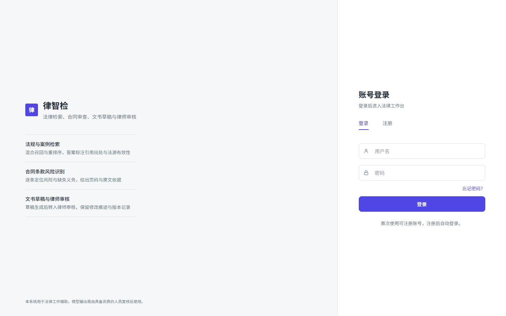

> 演示账号仅用于本地环境，公开部署时请修改口令或直接删除这些账号。

## 项目结构

```text
.
├─ app/
│  ├─ api/            # 表现层：HTTP / WebSocket 路由，按域分包
│  ├─ services/       # 业务层：legal / documents / rag / agent / billing ...
│  ├─ models/         # SQLAlchemy ORM 模型
│  ├─ schemas/        # Pydantic DTO
│  ├─ core/           # 配置、数据库、安全、LLM 网关、可观测性
│  ├─ mcp/            # MCP 工具注册、策略校验与执行
│  ├─ tools/          # Agent 工具：文档 / 法律 / SQL / 任务
│  └─ tasks/          # Celery 异步任务
├─ alembic/versions/  # 数据库迁移脚本
├─ frontend/          # Vue 3 + Vite 法律工作台
├─ docs/              # 架构、治理、评测与运维文档
├─ eval/              # 评测数据集、对照组与回归脚本
├─ scripts/           # 初始化、数据导入、评测与运维脚本
├─ tests/             # 后端测试（单元 / 契约 / 集成）
└─ docker-compose.yml # MySQL + Redis + API + Celery + 前端
```

## 验证

```powershell
# 后端测试
python -m pytest tests -q

# 迁移完整性
python -B scripts/check_migrations.py

# 前端构建与端到端测试
cd frontend
npm run build
npm run test:e2e

# 一键门禁（默认 11 段，含任务中心 20 条 mock e2e；--e2e 追加全量 e2e）
python scripts/check_all.py
```

更完整的分层测试、覆盖率、OpenAPI 契约与性能检查见 [测试与发布工程手册](docs/TESTING_AND_RELEASE.md)。

## 文档导航

| 主题 | 文档 |
| --- | --- |
| 架构与模块边界 | [ARCHITECTURE.md](docs/ARCHITECTURE.md) |
| 前端工作台信息架构 | [frontend-legal-workbench-redesign.md](docs/frontend-legal-workbench-redesign.md) |
| 多模态文档理解 | [MULTIMODAL_DOCUMENT_ANALYSIS.md](docs/MULTIMODAL_DOCUMENT_ANALYSIS.md) |
| MCP 策略与审计回放 | [MCP_POLICY_AS_CODE.md](docs/MCP_POLICY_AS_CODE.md) |
| 内部 A2A 协作 | [A2A_COLLABORATION.md](docs/A2A_COLLABORATION.md) |
| RAG 指标与评测 | [RAG_EVALUATION_GUIDE.md](docs/RAG_EVALUATION_GUIDE.md) / [EVAL_METRICS.md](docs/EVAL_METRICS.md) |
| 出站数据保护 | [llm-outbound-data-protection.md](docs/llm-outbound-data-protection.md) |
| 配置与环境变量 | [CONFIG.md](docs/CONFIG.md) |
| 发布与运维 | [operations-runbook.md](docs/operations-runbook.md) / [CANARY_AND_RELEASE.md](docs/CANARY_AND_RELEASE.md) |

## 发布说明

为了让仓库更适合公开发布，当前约定如下：

- 敏感配置只保留在本地 `.env`，仓库只提交 `.env.example`
- 日志、上传文件、构建产物、前端依赖与测试产物由 `.gitignore` 排除
- README 截图使用演示数据生成，不读取真实合同或生产导出
- 若怀疑 `SECRET_KEY`、`LEGAL_DATA_ENCRYPTION_KEY` 或任何 API Key 曾被提交，推送前先完成轮换

## 截图维护

README 中的图片位于 `docs/images/`。按上面的快速开始把前后端跑起来后，可重新生成：

```powershell
cd frontend
node scripts/capture-readme-screenshots.mjs
```

脚本默认以 `demo_lawyer` 登录，仅读取本地演示数据，不会上传文件、不会触发模型调用；管理员视角的截图从 `.env` 读取 `ADMIN_USERNAME` / `ADMIN_PASSWORD`，缺失时自动跳过。输出目录、前端地址与浏览器连接方式均可通过 `README_SCREENSHOT_*` 环境变量覆盖。

## 已知边界

- 当前定位是单团队 / 中小机构的私有部署，而非按租户分账的多租户 SaaS
- 法律咨询、条款识别与风险提示只能作为辅助意见，需由具备资质的人员复核，不构成正式法律意见
- 扫描件识别效果受原件清晰度、OCR 语言包与视觉模型可用性影响，降级时会返回明确告警而不是把空结果当结论
- RAG 效果依赖语料质量、切分策略与重排参数，评测数据与门禁在同一仓库内维护
- 极敏感数据在默认策略下会被阻断出站，需要接入本地模型或转人工处理
