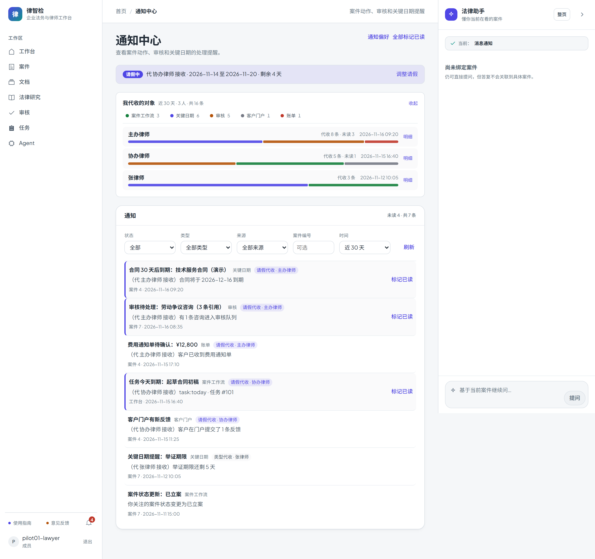

# 第一百二十九步交付说明：通知中心「我代收了谁」的视觉呈现

> 一句话：给代收汇总加一行五色图例（带条数）、把类型色段做成可点筛选、加高分布条，并留下桌面截图作为视觉验收。总资产 1640.6 → **1642.7 KB**（+2.1 KB）。

- 日期：2026-11-16
- 前端：`views/Notifications.vue`、`tests/e2e/notifications-center.spec.js`
- 文档：本篇 + `step129-notifications-visual.png`（桌面全页截图，1440×1000 @2x）
- 契约：OpenAPI **377 paths / 178 schemas / 28 error codes**（无接口变化）
- 迁移：**无新增**（仍 124 个，head `20261114_0123`）
- 测试：前端单测 129 不变；e2e 25（既有用例扩展）；后端 2710 不变

---

## 1. 视觉验收

一眼能看到的东西（从上到下）：

| 区域 | 视觉信息 |
| --- | --- |
| 请假提示条 | 「请假中」胶囊 + 「代 协办律师 接收 · 2026-11-14 至 2026-11-20 · 剩余 4 天」+「调整请假」 |
| 我代收的对象 · 头部 | 「近 30 天 · 3 人 · 共 16 条」+ 收起 |
| 图例 | 五个圆点：工作流 3 / 关键日期 6 / 审核 5 / 客户门户 1 / 账单 1 |
| 每人一行 | 姓名 + 代收/未读 + 最近时间 + **按类型配比的横向色条** + 「明细」 |
| 列表 | 每条带「请假代收 · 主办律师」「类型代收 · 张律师」标签，未读行左侧主色竖条 |

截图数据为全 mock（固定 7 条通知、3 位同事），用于验收排版与配色，不代表真实账号数据。

## 2. 做了什么

1. **图例**：五个类型各有一个圆点、名称与当前汇总内的合计条数；图例本身就是筛选器——点一下按该类型筛，再点取消。数字跟着时间窗与汇总口径变（不是全局常量）。
2. **色段可点**：分布条上的每一段从 `` 改成 `<button>`，点击只按该类型筛选（`@click.stop`，不会顺带按人筛选），悬停文案「关键日期 4 条，点击只看该类型」。
3. **分布条加高**：3px → 6px，段间 2px 间隙、2px 圆角，颜色透明度 0.9，悬浮/聚焦时高亮——在 1440 宽度下也能看清比例。
4. **布局微调**：行内改为「姓名/条数/时间」一行 + 「色条」一行（`main` 两行网格），色条与姓名左对齐；「明细」仍在最右。

## 3. 数字

| 项 | 改前 | 改后 |
| --- | --- | --- |
| 总资产（raw） | 1640.6 KB | **1642.7 KB**（+2.1） |
| 预算占比 | 96.5%（脚本 97%） | **96.6%（脚本 97%）** |
| 预算余量 | 59.4 KB | **57.3 KB** |
| 入口 / gzip / 最大 chunk | 82.2 / 28.4 / 87.0 | 不变 |
| 后端 / 单测 / e2e | 2710 / 129 / 25 | 不变（e2e 用例内扩展） |

## 4. 验证

- e2e 扩展：图例 5 项、审核项显示「审核1」；点图例 → 请求带 `event_type=approval` 且 URL 同步；再点取消 → 参数消失；点首位色段 → 同样带 `event_type=approval`；
- 色段类名与悬停文案（`seg-approval` / 「审核 1 条」）断言保留；
- 截图脚本：Playwright 1440×1000 @2x、全 mock 数据、`?days=30` 深链，产物 471 KB；
- 前端 lint 0 error（12 条既有 warning）；包体四项预算全绿；
- 全量门禁：**11/11，exit 0，19.7 分钟**；后端 **2710 passed / 4 skipped**（17 分 45 秒），前端单测 129、e2e 25、OpenAPI 377、迁移 124 全绿。

## 5. 边界

1. **图例数字是「当前汇总内」的合计**：切时间窗或按人筛选后，图例数字跟着变，不是全量口径。
2. **类型筛选会与按人/来源筛选叠加**：点图例不会清掉「正在看某某」，两者是交集（符合筛选器的直觉）。
3. **窄屏视觉仍不好看**：390px 下 copilot 面板占满首屏，通知中心被推到下方——这是全局布局问题，本步没有修（下面「后续」列了）。
4. **截图是 mock 数据**：固定 7 条通知、3 位同事，只为验收排版与配色。
5. **颜色是固定映射**：绿/主色/橙/灰/红对应工作流/关键日期/审核/门户/账单；与状态色无关。
6. **包体脚本显示 97%**：实际 1642.7/1700 = 96.6%，取整后 97%，95% 预警档仍在。

## 6. 后续建议

- **修窄屏下的 copilot 占位**：390px 时 copilot 面板默认收起或改成底部抽屉，让通知中心首屏可见（这是截图暴露出来的真实问题，属于全局布局）；
- 图例支持「悬停解释」：给每个类型加一句「什么算关键日期」的说明，降低理解成本；
- 若要继续压包体：`el-radio-group`（5.3 KB）与 `el-alert`（2.1 KB）是最容易动的下一档。
