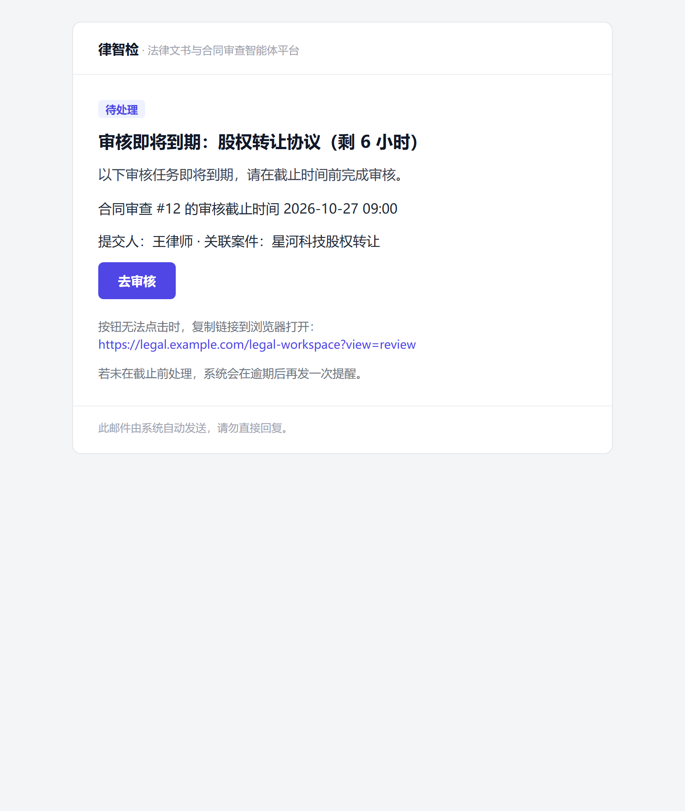

# 第三十八步交付说明：注册 HTML 邮件模板

> 一句话：审核 / 咨询类通知邮件不再是一坨纯文本——内置 7 个 HTML 版式（table + inline style，无外链），草稿同时存纯文本与 HTML，发送时走 `multipart/alternative`；没配前端地址就不渲染按钮，数据库模板命中时按运营文案发纯文本。

- 日期：2026-10-26
- 后端：`app/services/notification/email_templates.py`（新增，内置版式注册表）、`notification_service.py`（渲染优先级 + DLP 覆盖 HTML）、`outbound_email_service.py`（草稿 `content_html` + multipart 发送）、`app/models/email.py`（`EmailDraft.content_html`）、`app/core/config/reliability.py`（`NOTIFICATION_EMAIL_ACTION_BASE_URL`）
- 迁移：`20261026_0104`（`email_drafts.content_html`，MySQL 已执行）
- 测试：`tests/test_notification_email_html.py`（新增 9 条）、`tests/test_notification_template.py`（渲染优先级 5 条替换原回退 1 条）

---

## 1. 为什么是代码里的模板，不是种子数据

`notification_templates` 表是**运营覆写层**（版本化、可停用、可改文案），但它没有 HTML 版式字段；把 v1 版式放代码里，保证「组织一配好 SMTP 就能收到像样的邮件」，不依赖运维先跑一次种子脚本，也不需要在库里维护 7 行初始数据。

优先级（`notification_service._render_email_content`）：

1. **数据库模板**（`channel=email` + `template_key` + locale 命中）→ 运营文案，纯文本；
2. **内置 HTML 版式**（`email_templates.render_builtin_email`）→ 纯文本 + HTML 两版；
3. **都没有** → 回退事件标题/正文（step37 的行为，纯文本）。

内置注册的 7 个键与业务侧 `template_key` 一一对应：

| 通知 | template_key | CTA 文案 |
| --- | --- | --- |
| SLA 即将到期 | `review_sla_due_soon` | 去审核 |
| SLA 已逾期 | `review_sla_overdue` | 立即处理 |
| 无依据咨询待审核 | `review_consultation_uncited` | 去审核 |
| 依据偏弱咨询待审核 | `review_consultation_weak` | 去审核 |
| 咨询被退回（需补充依据） | `consultation_returned_supplement` | 去补充依据 |
| 咨询被退回（通用） | `consultation_returned` | 查看审核意见 |
| 咨询补充依据完成 | `consultation_supplemented` | 去复核 |

## 2. 版式与转义

- 统一外框 `_layout`：600px 卡片、品牌头（律智检 · 法律文书与合同审查智能体平台）、标题、导语、正文段落、CTA、页脚「此邮件由系统自动发送，请勿直接回复」；**只用 table + inline style**，不用 flex/grid/外链图片（邮件客户端兼容）。
- 所有参数 `html.escape` 后再进 HTML；`{{body}}` 按换行切段，不渲染任何外部 HTML。纯文本版保留原文（给人读的，不转义）。
- 深链：`NOTIFICATION_EMAIL_ACTION_BASE_URL` + `/legal-workspace?view=review`（`consultation`/`contract_review`/`draft`）或 `/notifications`（其他）。**未配置时不渲染按钮**，纯文本版也不出现空链接。

版式预览（`review_sla_due_soon`，Chromium 渲染内置 HTML 产物）：

## 3. 发送链路

1. `_dispatch_email` 拿 `(subject, text, html)`，DLP 扫描把 **HTML 也纳入**（链接/标签同样过规则）；
2. `create_notification_email(..., html_body=...)` → `EmailDraft.content_html`；
3. `_perform_send`：`message.set_content(text)`，有 HTML 时 `add_alternative(html, subtype="html")` → `multipart/alternative`。

`_draft_hash` **不含** `content_html`：内容哈希用于「草稿是否被改过」的幂等判断，加入新字段会让升级前已入队的请求（按旧公式算的 hash）在投递时被判为「草稿已变更」而拒绝。HTML 由同一事件内容派生，不是独立可变输入。

## 4. 顺带修的一个模板渲染缺陷

`notification_template_service.render` 原来只收集**正文**里的占位符：只在主题出现的 `{{title}}` 不会被替换，主题会把 `{{title}}` 原样发出去。现在主题 + 正文合并收集。

## 5. 验证

| 项 | 结果 |
| --- | --- |
| 注册表 | 7 个业务键全部注册，未知键返回 `None`；每个键渲染出 subject/纯文本/HTML |
| 转义 | `<script>` / `<b>` 在 HTML 里被转义，纯文本版保留原文 |
| 深链 | 未配 base URL：HTML 无 `<a href=`、纯文本无 http；配了 base URL：`consultation` 落 `/legal-workspace?view=review`、无 reference_type 落 `/notifications` |
| 发送 | 通知 dispatch → 草稿有 `content_html`；worker 发送得到 `multipart/alternative`，子类型顺序 `plain, html`，事件终态 `sent` |
| 回退 | 未注册模板键 → 只发 `text/plain`，事件仍 `sent`（不死信） |
| 优先级 | 数据库模板命中时用运营文案（纯文本），不再用内置版式 |
| 回归 | 通知 / Outbox / 模板 / SLA / 外发邮件 **44 passed** |

## 6. 边界

1. **HTML 只在代码里**：运营可以在数据库覆写文案，但覆写成纯文本会**顶掉**内置 HTML 版式（没有「只改文案保留版式」的能力）；要做需要给 `notification_templates` 加 `body_format` 与后台编辑页。
2. **版式是通用的**：7 个键共用一套外框，没有品牌色配置、没有 logo 图片（避免图片被客户端拦截）。
3. **深链只有一个入口**：所有审核类都落到「审核台」，不带具体记录 id（咨询/合同详情深链需要前端路由支持）。
4. **没有退订/偏好入口**：邮件渠道仍由通知偏好控制，但邮件里没有 unsubscribe 链接。
5. **DLP 更严了**：HTML 也参与扫描，理论上命中面比 step37 略大（含 URL 文本）。
