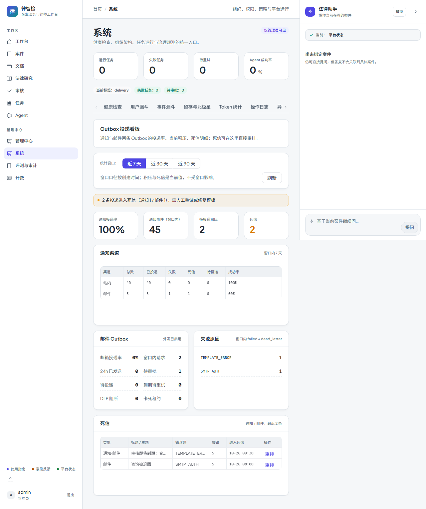

# 第三十九步交付说明：Outbox 投递看板

> 一句话：通知与邮件两条 Outbox 第一次有了统一的运营视图——窗口内投递率、按渠道分布、**当前**积压（待投递/到期待重试/卡死租约）、死信明细与失败原因，死信可以就地重排。

- 日期：2026-10-26
- 后端：`app/services/notification/delivery_ops.py`（新增，读库聚合 + 死信重排）、`app/api/admin/analytics_api.py`（`GET /analytics/outbox/overview`、`POST /analytics/outbox/dead-letters/{kind}/{id}/retry`）、`notification_service.requeue_dead_letter`、`outbound_email_service.requeue_dead_letter`
- 前端：`frontend/src/components/system/SystemDeliveryTab.vue`（新增「投递看板」tab，异步 chunk）、`api/analytics.js`（2 个方法）、`views/System.vue`
- 测试：`tests/test_delivery_ops.py`（11 条）、`tests/test_delivery_ops_api.py`（4 条）

---

## 1. 为什么读库，不读 `deliveries` 指标

`notification_deliveries` 是**进程内计数**（`app/core/metrics.py`），按快照窗口清零、按 labels 聚合，适合算 SLO 达成率，但回答不了运营真正要问的三件事：

1. **现在卡在哪一条？** —— 指标没有单据 id；
2. **积压多深、最老等了多久？** —— 计数会被快照清零，积压是状态不是增量；
3. **死信因为什么？** —— label 只有 `channel/status`，没有 `error_code` 与模板键。

所以看板直接读 `legal_notification_events` 与 `email_send_requests`，`notification_deliveries` 仍留在 SLO 页（step 里已有的 `/analytics/slo/*`），两者口径并列而不是替代。

## 2. 口径（先把容易混淆的三件事分开）

| 指标 | 定义 | 用途 |
| --- | --- | --- |
| `window` | 创建时间落在统计窗口内（7/30/90 天） | 投递率、渠道分布 |
| `backlog` | **当前**未完成（pending/approved/sending），不限窗口 | 积压深度、最老等待时长 |
| `rate` | 成功 /（成功 + 失败 + 死信） | 审批中、待投递**不计入分母**；无样本返回 `null`（前端显示 `-`） |

成功侧：通知 = `sent/delivered/read/acknowledged`，邮件 = `sent`；失败侧：`failed/dead_letter`。`blocked`（DLP 阻断）与 `rejected`（审批拒绝）单列，不混进成功率。

## 3. 数据与接口

`GET /api/analytics/outbox/overview?days=7&org_id=`（管理员）：

- `notification`：`total/by_status/by_channel[]`（渠道 × 总数/已投递/失败/死信/待投递/成功率）、`rate`、`backlog{pending,approved,sending,retry_pending,stale_claims,oldest_pending_at,oldest_pending_age_minutes,open_total}`、`dead_letters{total,items[]}`、`failure_codes[]`；
- `email`：同上 + `sent_24h`、`dlp_blocked`、`policy_enabled`、死信带**脱敏收件人**（`b***@corp.example.com`）；
- `alerts[]`：死信存在、租约卡死、到期待重试、有邮件记录但外发策略未启用——给前端顶部提示条用。

两个实现细节：

- 通知事件**没有** `dead_letter_at` 列（邮件请求有），列表按 `updated_at` 排序并原样返回，不伪造时间字段；
- 死信与失败原因都限制条数（20 条明细 / 10 个错误码），看板不翻页——需要全量走库表或日志。

## 4. 死信重排

`POST /api/analytics/outbox/dead-letters/{kind}/{item_id}/retry`：

- `kind=notification`：`dead_letter → pending`（走既有状态机），`attempt=0`、清 `next_retry_at/error_code/sanitized_error_message/claim_expires_at`；
- `kind=email`：`dead_letter → pending`（回到待审批，不跳过人工审批），复用 `_reset_dead_letter`；
- 权限：平台管理员（无组织）可操作任意组织，组织管理员只能操作本组织；越权 403 `OUTBOX_RETRY_FORBIDDEN`；
- 状态不对（不是死信）409 `OUTBOX_RETRY_INVALID_STATE`；单据不存在 404 `OUTBOX_ITEM_NOT_FOUND`；
- 幂等键保留：重排后不会因为「重新创建」而绕过数据库级去重。

## 5. 前端

系统中心新增「投递看板」tab（异步 chunk，不计入 System 路由 chunk）：

1. 窗口切换（7/30/90 天）+ 刷新；
2. 顶部提示条（来自 `alerts`，warning 用琥珀色）；
3. 四张指标卡：通知投递率 / 通知事件 / 待投递积压 / 死信；
4. 通知渠道表（渠道 × 各状态 × 成功率）；
5. 邮件 Outbox 键值块（投递率、24h 已发送、待审批、待投递、到期待重试、DLP 阻断、卡死租约）与失败原因榜（两类 Outbox 合并计数）；
6. 死信表：类型（通知·站内/通知·邮件/邮件）、标题/主题、错误码、尝试次数、进入死信时间、「重排」按钮。

页面（mock 后端，`system-delivery.spec.js` 截图）：

## 6. 真实数据快照（本地 MySQL，`days=30`）

| 指标 | 值 |
| --- | --- |
| 通知事件 | 45 条，全部 `site/delivered`，投递率 **1.0**，积压 0，死信 0 |
| 邮件请求 | 2 条，全部 `failed`，投递率 **0.0**，`policy_enabled=true` |
| 死信 | 0 |

这组数字正好说明口径分开的价值：站内是「即时 delivered」，邮件是「登记 Outbox 后由 worker 投递」，本地没跑 worker 时失败会停在 `failed`（未到 `dead_letter`），看板上表现为「投递率 0 + 积压 0 + 无死信」——不是数据丢失。

## 7. 验证

| 项 | 结果 |
| --- | --- |
| 窗口口径 | 构造 6 条窗口内 + 1 条 30 天前：`total=6`、成功 3、失败 1、死信 1、`rate=0.6`；渠道行 `site.rate=1.0` |
| 积压口径 | 窗口外 pending 仍计入 `backlog.pending`，`open_total=2`，最老等待 ≥ 30 天 |
| 死信 | 明细带 `template_key/error_code`；失败原因榜按码计数（`TEMPLATE_ERROR`/`SMTP_TIMEOUT`） |
| 邮件 | 状态计数、`sent_24h`、`dlp_blocked`、收件人脱敏、`policy_enabled=false` 时出现在 `alerts` |
| 重排 | 通知 → `pending` 且 `attempt=0`；邮件 → `pending`（待审批）；非死信 409；越权 403；不存在 404 |
| 接口 | 非管理员 403 `ADMIN_REQUIRED`；管理员 200 且结构完整；重排 200/404 稳定错误码 |
| 前端 | `eslint` 0 error；`vite build` 通过；包体预算通过（总资产 98%，见边界） |
| e2e | `system-delivery.spec.js`（全 mock）：页头/提示条/渠道表/死信两行渲染，点「重排」发出 `POST /analytics/outbox/dead-letters/notification/77/retry` 并提示「已重排为待投递」，无 4xx/5xx 与运行时报错 |

## 8. 边界

1. **看板是只读聚合 + 死信重排**：不能在页面上重发单条、编辑内容、批量重排；批量操作要另做接口。
2. **窗口按 `created_at`**：跨窗口的长期积压只看 `backlog`，没有「历史积压趋势」；趋势仍看 SLO 页的 `notification_deliveries` 快照。
3. **`org_id` 只过滤邮件 Outbox**：通知事件的组织过滤没做（事件本身有 `organization_id`，但站内是全局管理员视角）。
4. **分母口径**：`read/acknowledged` 算成功，会让「用户读得多」的窗口成功率偏高；需要更严口径时应只取 `sent/delivered`。
5. **时间比较走应用侧 UTC**：MySQL `created_at` 由库 `now()` 生成，库时区与应用 UTC 不一致时窗口边界会偏（既有代码同一口径，本次未改）。
6. **包体余量**：总资产已到预算 98%，再看板再加一个 chunk 就会触顶——后续要么拆共享依赖，要么提高预算并说明理由。
