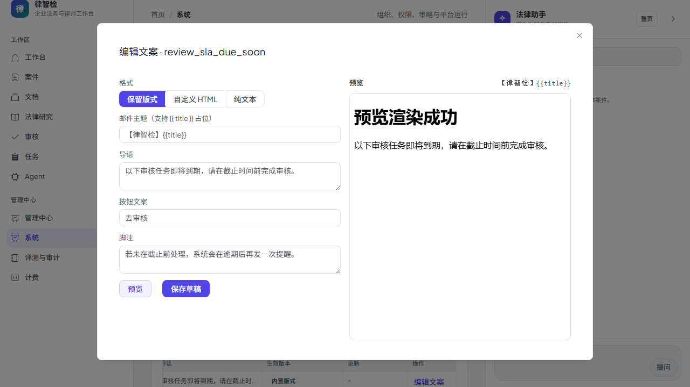
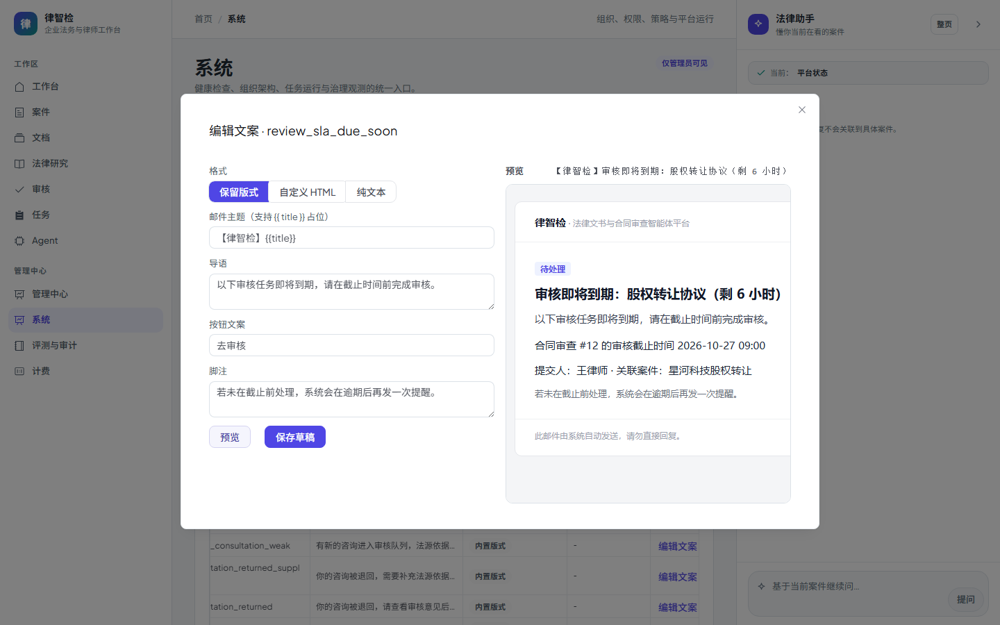

# 第四十步交付说明：通知模板可编辑（改文案不丢版式）

> 一句话：内置 HTML 版式仍由代码维护，但导语 / 按钮文案 / 脚注 / 主题可以在管理页改——`body_format=layout` 只覆写这 4 个字段，版式结构不动；需要整段自定义时切 `html`，要退回纯文本切 `text`。

- 日期：2026-10-27
- 后端：`notification_templates.body_format`（迁移 `20261027_0105`，MySQL 已执行）、`notification_template_service`（格式版本化 / 渲染实例 / 启用即退役旧版）、`email_templates`（layout 覆写解析 + HTML 转纯文本）、`notification_service`（渲染优先级）、新增 `app/api/admin/notification_template_api.py`
- 接口：`GET/POST /api/admin/notification-templates/`、`POST .../preview`、`POST .../{id}/activate`（均管理员）
- 前端：系统中心新增「通知模板」tab（异步 chunk）：模板列表 + 版本历史 + 编辑弹窗（格式切换 / 字段编辑 / iframe 预览 / 保存草稿 / 启用）
- 测试：`tests/test_notification_template_layout.py`（11）、`tests/test_notification_template_api.py`（9）、e2e `system-notification-templates.spec.js`（1）

---

## 1. 为什么加 `body_format` 而不是让运营写 HTML

step38 的边界是「数据库模板只能纯文本，覆写会顶掉 HTML 版式」。要解耦「改文案」和「保版式」，只有三种做法：

| 做法 | 问题 |
| --- | --- |
| 运营直接写整段 HTML | 改一句话也要维护版式；一次标签写错整封邮件就崩 |
| 把版式字段做成独立表 | 字段是固定 4 个，单开表收益低、迁移成本高 |
| **同表加 `body_format`** | 复用一个版本化表，三种语义用同一列区分 |

`body_format` 取值：

- `text`：历史行为，`body_template` 是纯文本，**不要** HTML；
- `html`：`body_template` 是整段 HTML，纯文本回退由服务端剥标签生成；
- `layout`：`body_template` 是 JSON 覆写（`subject/lead/action_label/footnote`），套内置版式渲染。

## 2. layout 覆写规则

- 白名单 4 个字段，长度上限：主题 120、导语/脚注 300、按钮 16 字；未知字段直接 400。
- 空值/缺失表示「沿用内置文案」——避免运营留空把导语清空。
- 主题既可写在 `layout.subject`，也兼容 `subject_template` 列（`layout.subject` 优先）。
- 覆写 JSON 坏了**不会让投递失败**：`_render_email_content` 捕获后回退内置版式并记 warning。

## 3. 版本与生效

- 新建立即 `draft`，必须显式启用；
- 同 `channel + template_key + locale + version` 唯一；内容或**格式**变化都会产生新版本（格式变化也建版本，否则覆写语义会被静默切换）；
- 启用时同 key+locale 的其它 `active` 版本自动转 `retired`，保证「一个键只有一个生效版本」；
- 渲染参数仍走 `params_schema_json` 校验 + HTML 转义，运营输入不会被当成标签执行。

## 4. 管理页

1. `邮件模板` 表：7 个内置键，显示当前导语、生效版本（内置 / 覆写 vN + 格式）、更新时间；
2. `版本历史` 表：所有数据库版本，草稿可一键启用；
3. 编辑弹窗：格式三选一 → 对应字段（layout 四字段；html/text 为正文 + 主题）→「预览」在 iframe（`sandbox=""`）里渲染 →「保存草稿」→「启用该版本」；
4. 顶部显示深链是否配置：未配置时预览/发送都不渲染按钮（不伪造链接）。

页面（mock 后端，`system-notification-templates.spec.js` 截图）：

真实后端（本地 MySQL + `127.0.0.1:8001`，管理员 token 直连）下同一路径的预览：iframe 里是服务端真实渲染的 HTML 邮件；当前 `.env` 未配 `NOTIFICATION_EMAIL_ACTION_BASE_URL`，所以按钮区为空——这是预期行为，不是渲染失败。

## 5. 验证

| 项 | 结果 |
| --- | --- |
| 覆写解析 | 白名单字段通过；未知字段 / 非 JSON / 超长 / 非字符串全部拒绝；空值回退内置 |
| 版式保留 | 覆写导语与按钮后 HTML 仍含 `role="presentation"` 结构，旧文案不残留，纯文本版同步替换 |
| 格式渲染 | `layout` 保留版式；`html` 用自定义正文且纯文本回退剥标签；坏 JSON 回退内置版式 |
| 版本语义 | 同内容同格式复用；格式变化产生新版本；启用后旧 active 转 retired |
| 接口 | 非管理员 403；列表返回 7 个内置键 + 4 个可覆写字段；预览不落库；未知键/非法字段 400；启用不存在版本 404 |
| e2e | 列表渲染 → 编辑弹窗 → 预览 iframe 出现「预览渲染成功」→ 保存草稿（POST 带 layout.lead）→ 启用（POST 20x）→ 提示「已启用」，无 4xx/5xx |
| 真实后端 | 本地 MySQL + uvicorn:8001 + vite:5173，管理员 token 直连：列表 7 个内置键、编辑弹窗预填内置文案、预览接口返回真实 HTML（主题「【律智检】审核即将到期：股权转让协议（剩 6 小时）」），未配置深链时按钮区为空 |
| 回归 | 通知相关 **54 passed**；门禁 10/10（15.2 分钟，exit 0） |

## 6. 边界

1. **layout 只覆盖 4 个文案字段**：想改版式（配色、品牌头、增加字段）仍要改代码内置模板。
2. **html 模式不安全内容靠转义**：参数会转义，但正文 HTML 本身是管理员输入，没有 HTML 消毒（管理员权限即信任边界）。
3. **没有草稿回滚 UI**：版本表能看历史、能启用任意旧版本，但没有 diff 与「回滚上一次」按钮。
4. **没有多语言管理**：接口支持 `locale`，页面固定用 `zh-CN`；`default` 走 fallback。
5. **预览参数是示例**：不接真实业务数据（标题/正文为固定样例），深链按当前配置生成。
6. **启用不重发历史**：只影响之后创建的通知事件；已入队的事件按渲染时的版本发送。
