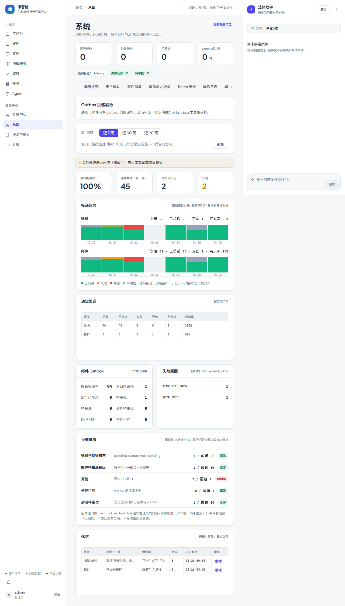

# 第四十一步交付说明：投递积压趋势与阈值告警

> 一句话：投递看板从「当前快照」变成「有趋势、会喊人」——按天看通知/邮件创建量与完成情况，5 项阈值每 15 分钟扫描，超阈值时给**该组织管理员**发站内 + 邮件告警，180 分钟冷却内不重复。

- 日期：2026-10-27
- 后端：`delivery_ops.evaluate_health` / `daily_trend`（阈值与分桶）、`app/services/notification/outbox_alerts.py`（按组织告警）、`app/tasks/notification_tasks.py::check_outbox_health`（beat 15 分钟）、`app/core/celery_app.py`（队列路由 + beat）、`app/core/config/reliability.py`（5 个阈值 + 冷却）
- 前端：`SystemDeliveryTab.vue` 新增「投递趋势」「投递健康」两块（纯 CSS 堆叠柱，不引图表库）
- 内置邮件模板：新增 `outbox_health_alert`（第 8 个内置版式，深链落 `/system?tab=delivery`）
- 测试：`tests/test_outbox_alerts.py`（10）、`tests/test_delivery_ops.py`（+2）、`tests/test_delivery_ops_api.py`（+2 断言）、`tests/test_task_routing.py`（新任务显式路由）

---

## 1. 趋势的口径（先说清楚它不是什么）

`daily_trend` 按**创建日**分桶，展示每天创建了多少事件、这些事件**当前**处于什么状态：

| 字段 | 含义 |
| --- | --- |
| `created` | 当天创建的事件数 |
| `delivered` / `failed` / `dead_letter` / `open` / `other` | 这些事件**现在**的状态分布 |
| `rate` | 当天批次的完成率 = 成功 /(成功+失败+死信) |

**它不是**「当日投递量」，也**不是**积压深度的历史曲线——系统没有落积压快照（step39 的边界仍然成立）。要做真正的吞吐/积压历史，得给看板加定时快照表，这一步没做。

窗口上限 30 桶（和 step27 的趋势一致），空白天补 0；`days` 传 90 也只返回 30 天。

## 2. 健康检查与阈值

`evaluate_health` 输出 5 项检查，`value >= threshold` 视为异常：

| 检查 | 默认阈值 | 口径 |
| --- | --- | --- |
| `NOTIFICATION_BACKLOG` | 50 | pending + approved + sending |
| `EMAIL_BACKLOG` | 50 | 待审批 + 待投递 + 投递中 |
| `DEAD_LETTER` | 1 | 通知 + 邮件死信 |
| `STALE_CLAIMS` | 1 | sending 且租约已过期 |
| `RETRY_STUCK` | 10 | failed 且已过 `next_retry_at` |

阈值都在 `reliability.py` 里可配（`OUTBOX_*_WARN_THRESHOLD`）。看板的顶部提示条与「投递健康」清单**同一份口径**：提示条是 `health.breached` 的人类可读投影，不再单独算一遍。

## 3. 告警任务

`check_outbox_health`（beat 每 15 分钟，notification 队列）：

1. 找有管理员账号的组织（`users.role='admin'` 且 `organization_id` 非空）；
2. 对每个组织跑一次 `evaluate_health`（通知与邮件都按组织过滤）；
3. 有超限项 → 给该组织每个管理员创建站内 + 邮件通知：
   - `template_key=outbox_health_alert`，标题「投递告警：N 项超阈值」；
   - 正文列出每项「值 / 阈值」，并提示去「系统 → 投递看板」处理；
4. **冷却**：`business_version = now // OUTBOX_ALERT_COOLDOWN_MINUTES`，进幂等键 → 同一组织同一用户同一渠道在一个窗口内只发一条（默认 180 分钟）；
5. 返回 `{checked_orgs, breached_orgs, notified_users, events, breached[], skipped}`，不写业务表；
   没有任何带组织的管理员时返回 `skipped="no_org_admin"` 并记 warning（平台管理员不收组织级事件）。

告警邮件用内置 HTML 版式（step38/40 的机制），深链 `/system?tab=delivery`。

## 4. 前端

「投递趋势」：通知/邮件各一条堆叠柱状带，柱高按当日创建量归一、段内按状态占比（已投递绿 / 失败琥珀 / 死信红 / 未完成灰），悬停显示当日明细，图例与口径说明在下方。

「投递健康」：5 项检查逐行展示「名称 / 口径 / 当前值 / 阈值 / 状态」，超阈值标红；底部说明扫描频率、冷却窗口与「平台管理员只看看板、不收组织级告警」。

页面（mock 后端，`system-delivery.spec.js` 截图，含趋势与健康检查）：

## 5. 验证

| 项 | 结果 |
| --- | --- |
| 阈值 | 默认阈值下：积压 3 / 邮件积压 1 / 死信 2 / 卡死 1 / 重试 1 → 仅死信与卡死超限；改阈值到 3 后积压也超限 |
| 健康 | 清空 pending/sending/dead 后 `healthy=true`、`breached=[]` |
| 趋势 | 7 天窗口返回 7 桶、今天日期正确、当天 created=5（含各状态）、空白天补 0；`days=365` 被截到 30 |
| 看板 | overview 带 `trend`/`health`；`alerts` 与 `health.breached` 同源；API 形状测试通过 |
| 告警 | 有死信时只通知本组织两个 admin（不通知普通成员、不通知平台账号）；同冷却窗口重复扫描不新增；跨窗口（+冷却+1 分钟）再发 |
| 隔离 | 另一个无死信的组织不产生告警事件 |
| 无组织管理员 | 把管理员都改成无组织后返回 `skipped="no_org_admin"`，不产生事件 |
| Celery | 直接调用 `check_outbox_health_task()`（patch SessionLocal）返回 `breached_orgs=1`、通知 ≥2 人 |
| 真实库 | 本地 MySQL 上 `admin_org_ids=[]`（唯一 admin 无组织）→ 任务返回 `skipped=no_org_admin`；看板 `healthy=true`、5 项检查全为 0；7 天趋势全 0（库内 45 条事件创建于 10-16~10-19，落在窗口外） |
| 路由 | 新任务 `check_outbox_health` 显式路由到 notification 队列，路由完整性测试通过 |
| 回归 | 投递/告警/模板相关 **34 + 29 passed**；门禁见提交说明 |

## 6. 边界

1. **趋势不是投递量**：创建日 + 当前状态，没有积压深度历史；要真吞吐曲线得加快照。
2. **告警只发组织管理员**：平台管理员（`organization_id IS NULL`）不接收组织级事件，只能看看板；只有平台管理员的部署会得到 `skipped=no_org_admin`（有 warning 日志），不会有任何告警。
3. **阈值是全局配置**：不能按组织设不同阈值，也没有告警升级（升级到上级/值班人）。
4. **冷却粒度是窗口**：窗口边界附近可能连发两次；本轮没有「处理后手动消除告警」。
5. **告警本身走通知 Outbox**：邮件渠道仍需组织外发策略 + SMTP + worker；邮件队列本身积压时，告警邮件也会晚到（没有旁路投递）。
6. **没有静默/免打扰**：告警不受用户通知偏好里的静默时段影响（偏好只决定渠道）。
