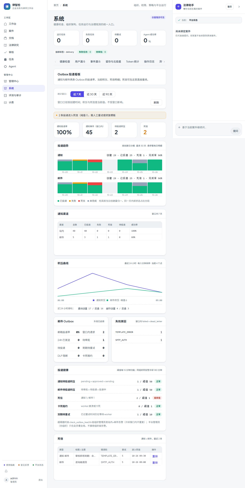

# 第四十二步交付说明：积压快照与真实积压曲线

> 一句话：投递看板终于能回答「凌晨两点积压涨到多少」——beat 每 5 分钟采样一行积压快照（平台级 + 每个有管理员的组织），保留 30 天；看板用 SVG 折线画 24 小时积压曲线，并给出每小时创建/投递吞吐。

- 日期：2026-10-27
- 后端：`OutboxSnapshot` 模型 + 迁移 `20261027_0106`（MySQL 已执行）、`app/services/notification/outbox_snapshots.py`（采样/清理/历史查询）、`delivery_ops.backlog_metrics`（健康检查与快照共用读数）、Celery 任务 `check_outbox_snapshot`（5 分钟）、`GET /api/analytics/outbox/history`
- 配置：`OUTBOX_SNAPSHOT_RETENTION_DAYS=30`、`OUTBOX_SNAPSHOT_MAX_ORGS=50`
- 前端：`SystemDeliveryTab.vue` 新增「积压曲线」卡片（SVG 折线 + 每小时吞吐汇总，不引图表库）
- 测试：`tests/test_outbox_snapshots.py`（7）、`tests/test_delivery_ops_api.py`（+3）、`tests/test_task_routing.py`（新任务路由）

---

## 1. 为什么必须落快照

step41 的趋势是「创建日 + 当前状态」：它能回答「昨天创建的 200 条现在完成了多少」，回答不了「昨天 2 点队列里压了多少条」——积压是**状态量**，事件明细里没有历史值。

所以新增一张窄表 `outbox_snapshots`：每次采样写一行，只存 8 个整数（通知/邮件的积压、死信、待重试、卡死租约）。按 5 分钟采样，一天 288 行/组织，30 天约 8600 行，索引 `(organization_id, captured_at)`。

`organization_id IS NULL` 是平台级（全部组织之和）；每个**有管理员**的组织另存一行——和告警任务的收件范围一致（平台管理员不接收组织级事件，见 step41 边界）。

## 2. 采样与保留

`check_outbox_snapshot`（beat 每 5 分钟，notification 队列）：

1. `backlog_metrics` 读一次当前积压（与 `evaluate_health` 共用同一份口径，避免看板/告警/快照三个数字）；
2. 平台级 + 组织级各写一行；组织数超过 `OUTBOX_SNAPSHOT_MAX_ORGS`（默认 50）时只保留前 50 个，返回 `truncated_orgs`；
3. 顺带 `prune_snapshots` 删除超过 `OUTBOX_SNAPSHOT_RETENTION_DAYS`（默认 30 天）的行，返回删除数。

任务返回 `{captured, organizations, truncated_orgs, pruned}`，可观测。

## 3. 历史查询

`GET /api/analytics/outbox/history?hours=24&org_id=`（管理员）：

- `backlog`：快照点数组（`at` + 通知/邮件积压 + 死信 + 待重试），`org_id` 缺省取平台级；没有快照时 `empty=true`；
- `throughput`：**每小时**创建/投递数，从 `created_at` / `sent_at` 直接分桶（不需要快照），空小时补 0；
- `hours` 限制 1–168；快照点最多取 5000 行，按时间升序。

小时桶表达式按方言取：MySQL `date_format`，SQLite `strftime`（测试库），其它方言回退到 SQLite 写法——文档里标注了这个限制。

## 4. 前端

「积压曲线」卡片：两条 SVG 折线（通知紫 / 邮件绿），纵轴按两条线峰值归一，横轴显示起止时间；点最多采样到 240 个再画（24h × 12 点/小时 = 288，直接画太密）。下方「近 24 小时吞吐」汇总通知/邮件的创建与投递数。

没有快照时显示空态并提示检查 beat 任务，不画假曲线。

## 5. 验证

| 项 | 结果 |
| --- | --- |
| 采样字段 | 平台级 + 组织级各一行；通知积压 3 / 死信 1 / 卡死 1 / 待重试 1、邮件死信 1 与构造数据一致 |
| 保留期 | 40 天前的快照被删、2 天前的保留（保留期 30 天） |
| 平台/组织隔离 | 平台查询不含组织行；组织查询只取本组织行 |
| 空态 | 无快照时 `empty=true`、`backlog=[]`，吞吐仍补齐 24 个小时桶 |
| 吞吐分桶 | 通知创建 6 / 投递 1、邮件创建 2 / 投递 1（SQLite `strftime` 分桶） |
| 边界值 | `hours=0` → 1；`hours=9999` → 168 |
| 接口 | 非管理员 403；管理员 200 且形状正确（快照点 + 6 个小时桶）；`hours=0` 422 |
| 真实库 | 本地 MySQL 执行迁移 0106 后 `capture_snapshots` 写 1 行平台快照（0 个带组织管理员）；`history` 返回 1 个点 + 24 个小时桶 |
| e2e | 投递看板 mock 后端：`/analytics/outbox/history` 被调用（`hours=24`）、两条折线渲染、吞吐汇总 `通知创建 17 / 投递 16` 可见，无 4xx/5xx |
| 门禁 | 见提交说明 |

## 6. 边界

1. **快照依赖 beat**：worker/beat 停摆时没有新点，曲线会断；看板不会插值，也不假装连续。
2. **5 分钟分辨率**：短于 5 分钟的尖峰抓不到；保留 30 天只适合周级回看。
3. **组织快照只覆盖有管理员的组织**：与告警收件范围一致；无管理员的组织只能看平台级曲线。
4. **吞吐不是「完成率」**：`sent_at` 是投递确认时间，失败/死信没有进吞吐曲线（失败看趋势与死信表）。
5. **时区**：快照时间用应用侧 UTC（`utc_now`），MySQL 的 `now()` 是服务器本地时间——两者不一致的部署里，曲线与吞吐桶会差一个时区偏移（既有口径，step39 已记录）。
6. **单方言回退**：非 MySQL/SQLite 的数据库小时桶会退回 SQLite 语法（生产若换库需补方言分支）。
