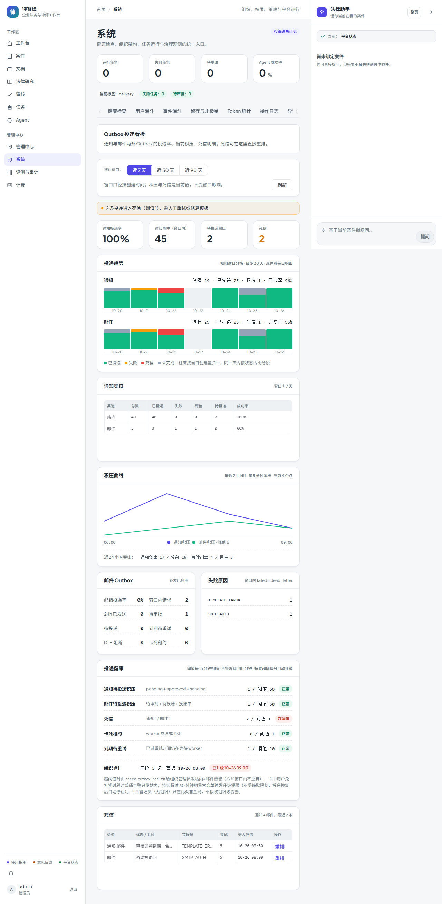

# 第四十三步交付说明：告警升级与静默时段

> 一句话：投递告警不再「发一次就安静」——持续越阈值超过 60 分钟会单独发升级提醒（独立模板、独立冷却、不受静默限制），命中用户免打扰时段的普通告警只发站内；每次扫描都记录持续次数，恢复时自动清零。

- 日期：2026-10-27
- 后端：`OutboxAlertState` 模型 + 迁移 `20261027_0107`（MySQL 已执行）、`outbox_alerts.py`（状态跟踪 / 升级 / 静默渠道）、`notification_service.preference_for` + `is_quiet_now`、`delivery_ops.open_alert_states`（看板展示升级进度）
- 配置：`OUTBOX_ALERT_ESCALATE_AFTER_MINUTES=60`、`OUTBOX_ESCALATION_COOLDOWN_MINUTES=180`、`OUTBOX_ALERT_RESPECT_QUIET_HOURS=true`
- 内置模板：新增第 9 个 `outbox_health_escalation`
- 前端：投递健康卡片增加「升级清单」（组织 / 连续次数 / 首次时间 / 已升级或待升级）+ 文案说明
- 测试：`tests/test_outbox_alerts.py`（22，含静默与升级）、e2e 投递看板

---

## 1. 状态表：让「持续」可判定

step41 的告警是无状态的：每次扫描按冷却窗口幂等发一条，但系统不知道「这个异常已经持续了多久」。新增 `outbox_alert_states`（每组织一行）：

| 字段 | 含义 |
| --- | --- |
| `first_breached_at` | 本轮首次越阈值时间（恢复后清空） |
| `last_breached_at` | 最近一次仍越阈值 |
| `breach_streak` | 连续越阈值次数（每次扫描 +1） |
| `last_alert_at` / `escalated_at` | 最近普通告警 / 升级提醒 |
| `resolved_at` | 最近一次恢复时间 |

恢复判定：某次扫描不再越阈值 → 清零 `breach_streak`、清空 `first_breached_at`、写 `resolved_at`，之后重新计时。状态只用于告警，不存投递数据。

## 2. 升级

`elapsed = now - first_breached_at >= OUTBOX_ALERT_ESCALATE_AFTER_MINUTES`（默认 60 分钟）时发升级提醒：

- 标题「投递告警升级：已持续 N 分钟」，正文列出每项「值 / 阈值」；
- 独立模板键 `outbox_health_escalation` + 独立冷却窗口 `OUTBOX_ESCALATION_COOLDOWN_MINUTES`（默认 180 分钟）→ 同一次持续异常最多每 3 小时升级一次；
- **不受静默时段限制**（升级的意义就是穿透静默）；
- 恢复后 `escalated_at` 不重置，但下一轮异常重新计时；`resolved_at` 可供看板/日志追溯。

任务返回新增 `escalated_orgs`、`escalation_events`、`resolved_orgs`、`quiet_users`。

## 3. 静默时段

判定在 `notification_service`：

- 读取生效偏好（`event_type=approval`，回退 `all`），取 `mute_start` / `mute_end`（HH:MM）与 `timezone`；
- 按偏好时区把 `now` 转成当地时间，分钟数落在窗口内即静默；**支持跨夜**（22:00–08:00）；起止相同或字段缺失视为未配置；时区非法回退 UTC；
- 普通告警命中静默 → 渠道降为 `["site"]`，正文追加「（静默时段，仅站内提醒；升级提醒不受静默限制）」；
- 升级提醒始终 `["site","email"]`；
- `OUTBOX_ALERT_RESPECT_QUIET_HOURS=false` 可整体关闭该行为（运维需要 24h 邮件时）。

偏好本身通过既有接口设置：`PUT /api/developer/notification-preferences/me?event_type=approval`（字段 `mute_start`/`mute_end`/`timezone`），没有单独的前端设置页——这是本步的已知缺口。

## 4. 看板

「投递健康」卡片：

- 头部说明改为「阈值每 15 分钟扫描 · 告警冷却 180 分钟 · 持续超阈值会自动升级」；
- 检查清单下方新增升级清单：`组织 #id · 连续 N 次 · 首次时间 · 已升级/待升级`；
- 数据来自 `outbox_overview.escalations`（未恢复的告警状态，最多 20 条）。

## 5. 验证

| 项 | 结果 |
| --- | --- |
| 状态跟踪 | 首次越阈值 `streak=1`、`first_breached_at` 有值；再扫一次 `streak=2`；恢复后 `streak=0`、`first_breached_at=None`、`resolved_at` 有值、`resolved_orgs=1` |
| 升级触发 | 61 分钟时每个管理员各收到一条升级（标题含「已持续 61 分钟」）；75 分钟（冷却内）不重复 |
| 静默 | 设 00:00–23:59 免打扰后：普通告警只有 `site` 且正文含「静默」；另一位无偏好管理员仍是 `site+email` |
| 升级穿透 | 同一静默用户仍收到 `site+email` 升级，正文不含「静默」 |
| 可关闭 | `OUTBOX_ALERT_RESPECT_QUIET_HOURS=false` 时静默用户恢复 `site+email` |
| 窗口解析 | 跨夜 22:00–08:00 在 01:30 为静默；09:00–18:00 在 01:30 不静默；起止相同/无偏好不静默；非法时区回退 UTC 不抛异常 |
| 接口/看板 | overview 返回 `escalations`；e2e 断言「组织 #1」「连续 5 次」「已升级 10-26 09:00」/「待升级」可见 |
| 回归 | 通知/投递/快照相关 **45 + 22 passed**；门禁见提交说明 |

## 6. 边界

1. **静默只作用于普通告警**：升级提醒始终双渠道；`OUTBOX_ALERT_RESPECT_QUIET_HOURS` 只能整体关闭。
2. **偏好没有前端设置页**：只能通过 `PUT /api/developer/notification-preferences/me?event_type=approval` 配置 `mute_start/mute_end/timezone`。
3. **升级没有值班/转派**：仍发给同组织管理员；不升级到平台管理员（平台账号不收组织级事件，step41 的边界延续）。
4. **升级阈值不按告警项区分**：任一检查持续超阈值都会升级，不区分严重度（死信与积压同等对待，只有普通告警里的 `level` 不同）。
5. **状态表按组织一行**：同一组织多个检查同时异常只记一个 streak；想看逐项持续时长需拆表。
6. **没有手动「已知悉/静音」**：处理完但指标未恢复时，告警仍会按节奏重发，直到指标恢复。
7. **时区口径**：静默按偏好时区解释，其他时间窗（趋势/快照）仍用应用 UTC——两者不一致时看板与静默窗口会差一个偏移。
