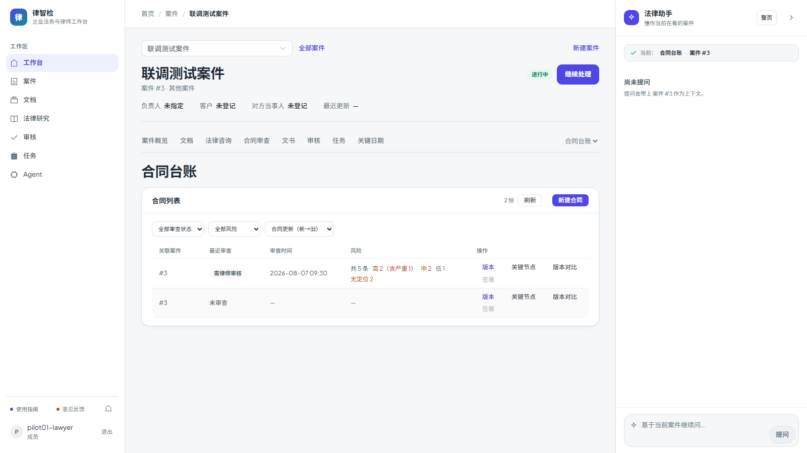

# 第四十五步交付说明：台账按审查时间排序 + 严重度细分计数

> 一句话：台账不再只能按「合同更新时间」排，也不能只看到「高风险」一档——摘要表补了 `critical / medium / low` 三列，列表接口新增 `sort/order`（白名单 4 个字段，未审查始终排最后），前端加排序下拉、审查时间列与「高（含严重）/ 中 / 低 / 无定位」分布。

- 日期：2026-10-27
- 后端：`LegalContractReviewSummary` 扩三列 + 迁移 `20261027_0109`（MySQL 已执行）、`contract_review_summary.py`（计数）、`legal_contract_listing.py`（排序/筛选/可见性改写）、`legal_contract_api.py`（`sort`/`order` 参数）
- 前端：`LegalContracts.vue`（排序下拉、审查时间列、严重度分布）、`contracts-flow.spec.js`（e2e 断言 + 截图）
- 测试：`tests/test_contract_listing_review.py`（13）、`tests/test_contract_summary_backfill.py`（5，含 0109 回填）

---

## 1. 摘要扩列：口径先说清

迁移 `0109` 给 `legal_contract_review_summaries` 加三列（默认 0）：

| 列 | 含义 |
| --- | --- |
| `risks_critical` | `risk_level == critical`，是 `risks_high` 的**子集** |
| `risks_medium` | `risk_level == medium`；未知/缺失级别也归这里 |
| `risks_low` | `risk_level == low` |

保持不变的口径：

- `risks_high` 仍是 **high + critical**（step36 起就这么定义），所以「高风险合同」筛选不受影响；
- `risks_total` 仍是 `risks_json` 里合法 dict 的条数；
- 因此 `risks_high + risks_medium + risks_low == risks_total`，且 `risks_critical <= risks_high`。

未知级别归 medium 不是拍脑袋：跨审查统计页 `contract_risk_stats.summarize_contract_risk_stats` 早就这么归一，台账跟着它，两个页面才不会对同一份审查报出不同分布。

刷新逻辑仍在 `refresh_contract_review_summary`（6 类写入路径同事务），只多算三列；迁移的 `_backfill(bind)` 只回填这三列，**不动** total/high/unanchored。

## 2. 排序：白名单 + 空值最后 + 稳定分页

`GET /legal/orgs/{org_id}/contracts` 新增：

| 参数 | 取值 | 默认 |
| --- | --- | --- |
| `sort` | `updated_at` / `created_at` / `reviewed_at` / `review_updated_at` | `updated_at` |
| `order` | `asc` / `desc` | `desc` |

- 只接受白名单字段，service 里再做一次兜底（非法值回退 `updated_at`），不拼接列名；
- `reviewed_at` / `review_updated_at` 来自 LEFT JOIN 的摘要表，**未审查为 NULL**：用 `CASE WHEN col IS NULL THEN 1 ELSE 0 END` 把空值固定排最后，`order=asc` 也不把未审查顶到前面；
- 同一时间按 `legal_contracts.id DESC` 兜底，翻页不会因时间相同而抖动。

响应里回显 `sort` / `order`（前端目前不消费，便于排障与后续做「当前排序」提示）。

## 3. 可见性改写：JOIN 成员表 → EXISTS

原来为了判断「严格案件成员」`LEFT JOIN legal_case_members`，再用 `SELECT DISTINCT` 去重。加 `ORDER BY CASE ...` 后，MySQL 的 `DISTINCT + ORDER BY 非选择列表达式` 会报 3065，所以改成相关子查询：

```sql
AND (
  contract.case_id IS NULL
  OR legal_cases.is_strict_mode IS NULL
  OR legal_cases.is_strict_mode = 0
  OR EXISTS (SELECT 1 FROM legal_case_members m
             WHERE m.case_id = contract.case_id AND m.user_id = :user
               AND m.revoked_at IS NULL)
)
```

顺带解决了两个老问题：同一用户在同一案件有多条成员记录时，JOIN 会把合同行放大、`COUNT(DISTINCT)` 只是遮住了重复；现在 `COUNT(*)` 就是真实行数。成员表本身没有 `(case_id,user_id)` 唯一约束，重复记录仍可能出现，但不会再影响台账。

## 4. 前端

- 筛选条新增排序下拉：`合同更新（新→旧）` / `审查时间（新→旧）` / `审查时间（旧→新）`，值拆成 `sort`+`order` 传给后端；
- 风险筛选新增「有严重风险 / 有中风险 / 有低风险」，保留「有高风险 / 有无定位 / 未审查」；
- 表格新增「审查时间」列；风险列改为分布：`共 N 条`、`高 n（含严重 m）`、`中 n`、`低 n`、`无定位 n`，零项不渲染；
- 台账列多、案件工作区窄，表格保持横向滚动（ElTable 自带），截图特意滚到右侧让新列可见。



## 5. 验证

| 项 | 结果 |
| --- | --- |
| 严重度计数 | 5 条风险（critical/high/medium/low/未标级别）→ total 5、high 2、critical 1、medium 2、low 1；`high+medium+low == total` |
| 严重度筛选 | `critical` / `high` / `medium` 各命中 1 份；`low` 命中 2 份（含只有低风险的那份），`total` 与 items 一致 |
| 审查时间排序 | 降序 `[较新, 较早, 未审查]`；升序 `[较早, 较新, 未审查]`——NULL 两个方向都在最后 |
| 平局稳定 | 同一 `reviewed_at` 的两份合同按 id 倒序，分页首屏顺序确定 |
| 排序白名单 | 传 `sort="risks_high; drop table"`、`order="sideways"` 回退 `updated_at/desc`，查询正常 |
| 严格案件可见性 | 非成员 0 条；加两条重复成员记录后仍 1 条（不放大）；全部撤销后 0 条 |
| 迁移回填 | 直接调 0109 `_backfill`：critical/medium/low 正确，total/high 原值不动；无 review 的摘要行保持 0 |
| 真实 MySQL | 迁移 `0108 → 0109` 执行成功；4 个排序字段 × 升降序共 8 组查询全部执行（本地 2 份合同均未审查，`risk=none` 命中 2）；严重度筛选均返回 0——本机摘要表为空，非零分布只在单测/ mock e2e 里验证 |
| 回归 | 合同/审查/可见性相关 **76 passed** |
| e2e | `contracts-flow.spec.js` 1 passed（14.6s，全 mock）：断言 `共 5 条 / 高 2（含严重 1）/ 中 2 / 低 1 / 无定位 2 / 2026-08-07 09:30`，并验证排序与 `risk=critical` 参数下推 |
| 门禁 | 10/10，13.8 分钟，exit 0（见 §7） |

## 6. 边界

1. **排序只支持白名单 4 列**：按风险数、相对方、合同编号排序都没做；需要时加列并补索引，不是改个参就行。
2. **未审查永远最后**：`reviewed_at` 为 NULL 的记录不参与升序「最早在前」的语义；未审查数量大时，前几页仍会被已审查合同占满。
3. **`critical` 不单独进 total**：它是 `risks_high` 的子集，前端展示为「高 n（含严重 m）」；如果以后要按「仅 critical」筛选，已有 `risk=critical`，但「排除 critical 的高风险」没有对应参数。
4. **未知严重度按 medium**：与跨审查统计一致，但与 `risks_json` 里的原始值不同；要精确分布得回查审查原文。
5. **迁移只回填已有摘要行**：`review_id` 为空或指向已删除审查的行无法重算，三列保持 0；这类行本来就不该存在（摘要删除逻辑会删行），属兜底。
6. **排序没有索引**：`reviewed_at` 在摘要表、组织过滤在合同表，走 JOIN 后必然 filesort；本期不加索引（`reviewed_at` 选择度低、写入放大），上万份合同的机构需要再评估。
7. **分页是 OFFSET**：排序键相同用 id 兜底，但翻页期间新增/删除合同仍可能重复或漏一条；要彻底稳定得改 keyset 分页。
8. **`risk=medium` 是「有中风险」**：不是「只有中风险」；同时有高、中风险的合同会同时出现在两个筛选结果里。
9. **成员子查询是相关子查询**：每行执行一次 `EXISTS`，成员表有 `(case_id)` 与 `(user_id)` 索引，当前量级没问题；成员表仍缺 `(case_id,user_id)` 唯一约束。
10. **前端排序控件只有三个选项**：没有「合同创建时间」与「审查更新时间」入口（API 支持，UI 未暴露）；排序状态不进 URL，刷新后回到默认。

## 7. 门禁

- `scripts/check_all.py`：**10/10，13.8 分钟，exit 0**（本树最终状态；后端 2442 passed / 4 skipped）。
- 包体：总资产 **1686.1 / 1700 KB（99%）**，`LegalContracts` chunk 14.70 KB raw（5.04 KB gzip）；OpenAPI 路径 **356**；前端单测 **96 passed**。

## 8. 回滚

- 代码：`sort`/`order` 有默认值，旧前端不传即回到 `updated_at desc`；前端单独回滚只会少排序控件与分布列，接口仍兼容。
- 数据库：`alembic downgrade 20261027_0108` 删除三列（先确认没有依赖这三列的下游）；摘要表本身与回填逻辑不受影响。
