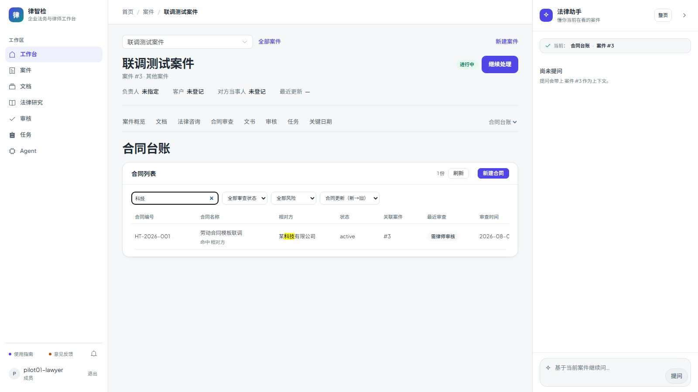

# 第四十八步交付说明：搜索结果高亮与命中字段提示

> 一句话：搜索「科技」时，列表不再只少几行——相对方里的「科技」被高亮，合同名称下面标注「命中 相对方」；搜「采购」标「命中 名称」，搜合同编号标「命中 编号」。高亮用文本切分渲染，不拼 HTML。

- 日期：2026-10-27
- 后端：`legal_contract_listing.py`（`search_hit`，列表项附 `search.query` / `search.matched_fields`）
- 前端：`LegalContracts.vue`（`HighlightText` 函数式组件、命中字段提示、`<mark>` 样式）
- 测试：`tests/test_contract_listing_review.py`（命中字段断言）、e2e `contracts-flow.spec.js`（三类字段高亮 + 提示）
- 截图：`step48-contract-search-highlight.png`

---

## 1. 返回给前端的命中信息

每个列表项新增（无搜索词时为 `null`）：

```json
{
  "search": {
    "query": "科技",
    "matched_fields": ["counterparty"]
  }
}
```

- `query`：归一空白后的搜索词；
- `matched_fields`：`title` / `counterparty` / `contract_no` 中**字面子串**命中的字段；
- 这是**展示口径**，不参与搜索判定。MySQL 的 ngram 短语可能命中分词边界而字面不连续，此时 `matched_fields` 为空，前端显示「命中 分词匹配」，不硬猜字段。

为什么不放在前端算：手机端/其它 API 消费者也能拿到同样的提示；同时避免前端和后端对「命中哪个字段」各写一套。

## 2. 前端高亮

`HighlightText` 是函数式组件：

```js
highlightParts(text) // 按搜索词切成 [{text, hit}]，命中段用 <mark> 渲染
```

- 不拼 `v-html`，所有文本走 Vue 文本节点，搜索词里的 `<script>` 只会显示成字符；
- 三列都套用：合同编号、合同名称、相对方；
- 合同名称下方显示「命中 名称 / 相对方 / 编号」；多个字段同时命中用 ` / ` 连接；
- 搜索词为空时组件原样输出文本，不产生 `<mark>`；
- 高亮用 `--color-warning-light` 背景 + `--color-warning` 文字，和现有警示色一致。



## 3. 验证

| 项 | 结果 |
| --- | --- |
| 标题命中 | `q=劳动` → `search.matched_fields=["title"]` |
| 相对方命中 | `q=科技` → `["counterparty"]` |
| 编号命中 | `q=HT-2026-002` → `["contract_no"]` |
| 无搜索 | 列表项 `search=null` |
| 高亮切分 | 每个命中段是独立 `<mark class="search-hit">`，其余文本保持原样 |
| e2e | 1 passed（15.1s，全 mock）：`科技` → 提示「命中 相对方」+ `<mark>科技</mark>`；`采购` → 「命中 名称」；`HT-2026-003` → 「命中 编号」 |
| 单测 | 台账 18 passed |
| 门禁 | 见 §5（本树跑完回填） |

## 4. 边界

1. **提示是展示口径**：按字面子串判定，和 MySQL ngram 的分词命中可能不完全一致；字面不连续时显示「分词匹配」。
2. **大小写不敏感**：高亮与字段判定都用 `casefold`，但 MySQL 本地排序规则是 `utf8mb4_0900_as_cs`，搜索本身区分大小写；可能出现「后端没返回、前端也无需高亮」或反之的极端情况。
3. **只标三列**：风险、审查状态等字段不参与搜索，也不会高亮。
4. **不改变搜索范围**：提示只解释结果，不会因为某字段没命中就不返回该行。
5. **多字段命中会并列**：例如名称和相对方都含「科技」，提示为「命中 名称 / 相对方」。
6. **高亮不做分词**：搜索词按整段匹配；输入带空格的短语时，只有连续出现才高亮。
7. **超长文本会省略**：合同名称列用 CSS 省略号，完整标题仍可通过 `title` 属性查看；高亮只在可见文本里。
8. **`search` 是新增响应字段**：旧前端忽略即可；移动端/第三方要展示提示需自行读取。

## 5. 门禁

- `scripts/check_all.py`：**10/10，14.8 分钟，exit 0**（本树最终状态；后端 2447 passed / 4 skipped）。
- 包体：总资产 **1689.5 / 1700 KB（99%）**，`LegalContracts` chunk 17.37 KB raw（5.95 KB gzip）；OpenAPI 路径 **356**；前端单测 **96 passed**。
