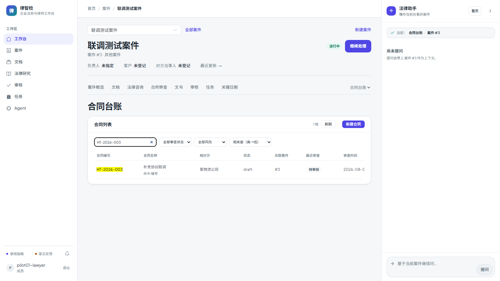

# 第四十九步交付说明：按相关度排序（与时间排序并列）

> 一句话：搜索后排序下拉多了一项「相关度（高→低）」——MySQL 用 `MATCH ... AGAINST` 的全文分数排序，SQLite/单字查询用「名称 3 / 相对方 2 / 编号 1」的加权命中；游标里带分数 + 合同 id，翻页仍然不重不漏。

- 日期：2026-10-27
- 后端：`legal_contract_listing.py`（相关度表达式、float 游标、排序分支）、`legal_contract_api.py`（`sort=relevance` 白名单）
- 前端：`LegalContracts.vue`（相关度选项仅在有关键词时可用；清空关键词自动回到默认排序）
- 测试：`tests/test_contract_listing_review.py`（相关度排序 + 翻页 + 无关键词报错）、e2e `contracts-flow.spec.js`（选项禁用/启用、`sort=relevance` 下推、清空回退）
- 截图：`step49-relevance-sort.png`

---

## 1. 相关度从哪来

| 场景 | 分数 |
| --- | --- |
| MySQL + 关键词 ≥ 2 字 | `MATCH(title, counterparty, contract_no) AGAINST ('"关键词"' IN BOOLEAN MODE)` 返回的全文分数 |
| SQLite / 非 MySQL / 单字查询 | 名称命中 3 分 + 相对方命中 2 分 + 编号命中 1 分 |

- MySQL 侧复用 step47 建的 ngram 全文索引，不新增索引；
- SQLite 是开发/测试方言，没有 ngram；单字查询在 MySQL 上也无法走全文索引，两者统一用加权 LIKE；
- 加权顺序对应「名称最相关、相对方次之、编号最后」，只是可解释的兜底，不是语义模型。

## 2. 游标：分数 + 合同 id

相关度排序的 keyset 条件：

```sql
score < :cursor_score
OR (score = :cursor_score AND contract_id < :cursor_id)
```

- 游标里的 `k` 从时间字符串变成 **float 分数**，`i` 仍是合同 id；
- 同分记录按 id 倒序兜底，翻页不重不漏；
- 只允许 `segment=value`（相关度没有「空值尾段」）；
- 搜索结果本身由 `q` 过滤，`q` 变化会让筛选指纹不匹配，游标直接 400。

`ORDER BY score DESC` 无法用 B-Tree 索引顺序，MySQL 会对**已经由全文索引筛出的命中行**做 filesort；命中集通常远小于全表，宽泛搜索词（如「合同」）时才会明显。

## 3. 前端

- 排序下拉新增「相关度（高→低）」，放在时间排序前面；
- 无搜索词时该选项 `disabled`，避免选了一个没有定义的排序；
- 清空搜索词时，如果当前是相关度排序，自动切回「合同更新（新→旧）」并重载；
- `splitSort('relevance_desc')` → `sort=relevance&order=desc`，沿用现有请求序号与游标逻辑。



## 4. 验证

### 4.1 单测（SQLite）

| 项 | 结果 |
| --- | --- |
| 加权顺序 | 名称命中 → 3 分、相对方命中 → 2 分、编号命中 → 1 分，降序返回 3/2/1 |
| 相关度翻页 | 每页 2：第一页 3 分 + 2 分、第二页 1 分；两页无重复 |
| 无关键词 | `sort=relevance` 且 `q` 为空 → `ValueError`（API 转 400） |
| 搜索命中提示 | 三条记录分别标 `title` / `counterparty` / `contract_no` |
| 回归 | 台账 20 passed |

### 4.2 MySQL（临时 300 份合同，验证后已清理）

| 项 | 结果 |
| --- | --- |
| `q=劳动合同` + 相关度 | 100 条，第一条为标题命中 |
| `q=科技` | 100 条，相对方命中 |
| `q=HT-PUR-0001` | 1 条，编号命中 |
| `q=劳`（单字，LIKE 回退） | 100 条，相关度走加权分支 |
| 相关度分页 | 每页 20：两页交集 0 |
| **完整走完** | 5 页共 100 条、去重后仍 100 条（float 游标无跳过/重复） |
| 同分 | 100 条分数相同（同一短语），靠 id 兜底稳定 |

### 4.3 e2e

`contracts-flow.spec.js` 1 passed（16.9s，全 mock）：无搜索词时「相关度」选项禁用；搜索编号后启用并选中，请求带 `sort=relevance&order=desc`；清空搜索词后自动回到 `updated_at`，表格恢复第一页。

### 4.4 门禁

见 §6（本树跑完回填）。

## 5. 边界

1. **相关度只在搜索时可用**：没有 `q` 时 API 返回 400，前端选项禁用；它不是「全局推荐排序」。
2. **MySQL 分数不是语义相关度**：是 ngram 词频/逆文档频率的全文分数，不含同义词、点击反馈或模型排序；语料变化会影响绝对值，跨时间不可比。
3. **两种分数口径不同**：MySQL 用全文分数，SQLite/单字用 3/2/1 加权；同一批数据在不同方言下顺序可能不同。
4. **全文排序要 filesort**：排序发生在命中集上，宽泛关键词（命中几千条）会慢；要更快只能上搜索引擎或预计算。
5. **同分按 id 倒序**：分数相同的记录顺序稳定，但不代表业务优先级。
6. **游标是 float**：依赖 MySQL 对同一表达式返回相同 double；已用 100 条完整翻页验证，但极端浮点差异仍可能造成边界重复/跳过（概率极低）。
7. **`order=asc` 后端允许**：会得到「最不相关在前」，UI 只暴露降序。
8. **相关度不改变搜索范围**：只在命中的行里排序，不会把不匹配的合同带进来。

## 6. 门禁

- `scripts/check_all.py`：**10/10，12.3 分钟，exit 0**（本树最终状态；后端 2449 passed / 4 skipped）。
- 包体：总资产 **1689.7 / 1700 KB（99%）**，`LegalContracts` chunk 17.57 KB raw（6.06 KB gzip）；OpenAPI 路径 **356**；前端单测 **96 passed**。
