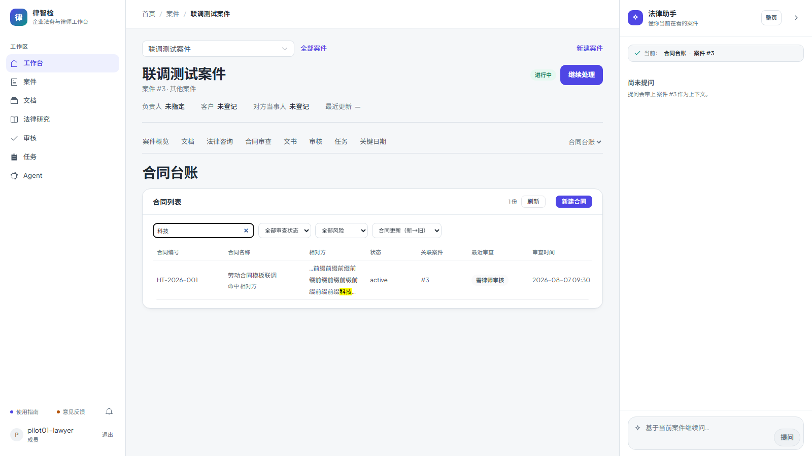

# 第五十步交付说明：长文本摘要命中片段（命中词前后 20 字）

> 一句话：搜索命中长标题/长相对方时，表格不再铺整段文本，只显示「命中词前后各 20 字」的片段，两端补省略号；命中词仍然高亮，单元格最多三行，完整片段在 `title` 里可悬停查看。

- 日期：2026-10-27
- 后端：`legal_contract_listing.py`（`SNIPPET_RADIUS=20`、`_snippet`、`search.snippets`）
- 前端：`LegalContracts.vue`（`cellText` 优先取片段、三行截断、列宽 140/160/120）
- 测试：`tests/test_contract_listing_review.py`（21，含片段边界/短字段/编号片段）、e2e `contracts-flow.spec.js`（长相对方片段 + 高亮）
- 截图：`step50-search-snippet.png`

---

## 1. 片段规则

后端在 `search` 里新增 `snippets`：

```json
"search": {
  "query": "科技",
  "matched_fields": ["counterparty"],
  "snippets": {
    "counterparty": "…前缀前缀…科技后缀后缀…"
  }
}
```

- 以**第一个命中位置**为中心，向前取 20 个字符、向后取 20 个字符；
- 起点 > 0 补 `…`，终点 < 文本长度补 `…`；
- 字段本身较短（命中词前后不足 20 字）时返回原文，不补省略号；
- 只给 `matched_fields` 里的字段生成片段，没有命中的字段不返回；
- 片段是**展示数据**，不改变搜索与排序，也不替代列表里的 `title` / `counterparty` 原值。

## 2. 前端

- 搜索时 `cellText(row, field)` 优先取 `row.search.snippets[field]`，没有片段或未搜索时用原值；
- 名称、相对方、编号三列都接片段；名称与相对方最多三行（`-webkit-line-clamp: 3`），避免 40+ 字片段把行撑到五六行；
- 命中词仍由 `HighlightText` 切分渲染 `<mark>`，片段里的 `…` 保持普通文本；
- 单元格 `title` 指向片段本身，悬停可看完整片段（不是整段原文）；
- 列宽同步收紧：合同编号 150→140、名称 180→160、相对方 140→120，整表少 50px。



## 3. 验证

| 项 | 结果 |
| --- | --- |
| 长标题 | 30 个「甲」+「劳动合同」+30 个「乙」，命中「劳动」→ `…` + 20 甲 + 劳动合同 + 18 乙 + `…` |
| 长相对方 | 25 个「丙」+「科技」+25 个「丁」→ `…` + 20 丙 + 科技 + 20 丁 + `…` |
| 长编号 | `HT-` + 20 个 0 +「劳动」+20 个 9 → 前面补 `…`，末尾无截断则不补 |
| 短字段 | 「劳动合同」命中「劳动」→ 原文，不补省略号 |
| 命中字段 | `snippets` 只包含 `matched_fields` 中的字段 |
| e2e | 1 passed（16.5s，全 mock）：长相对方搜索「科技」→ 单元格含 `…`、`<mark>科技</mark>`、提示「命中 相对方」；截图见上 |
| 单测 | 台账 21 passed |
| 门禁 | 见 §5（本树跑完回填） |

## 4. 边界

1. **片段只是展示**：搜索与排序仍按完整字段；片段不会改变命中范围。
2. **按字符截取，不按字节**：中文 1 字 = 1 字符；截断后可能出现半个词组，属预期。
3. **大小写折叠的长度差异**：匹配位置用 `casefold`/`lower` 计算，个别语言（如 ß）折叠后长度变化可能让截取位置偏一位；法律台账以中英文为主。
4. **只取第一个命中**：同一字段出现多次搜索词时只围绕第一次出现截取。
5. **最多三行**：片段本身仍是 20+关键词+20 字，窄列里可能被 CSS 截掉尾部；完整片段通过 `title` 悬停查看。
6. **片段不返回整段原文**：列表原值仍在 `title` / `counterparty` 字段里；片段只用于单元格展示。
7. **无 HTML 拼接**：片段是纯文本，高亮由前端文本切分完成，`<mark>` 不来自后端。
8. **不缓存**：片段每次随列表响应生成，按当前搜索词计算；数据更新后下一次查询自然刷新。

## 5. 门禁

- `scripts/check_all.py`：**10/10，14.4 分钟，exit 0**（本树最终状态；后端 2450 passed / 4 skipped）。
- 包体：总资产 **1690.4 / 1700 KB（99%）**，`LegalContracts` chunk 17.98 KB raw（6.16 KB gzip）；OpenAPI 路径 **356**；前端单测 **96 passed**。
