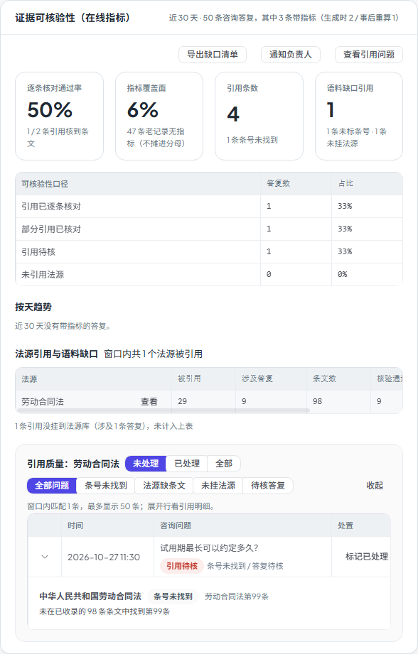

# 第五十一步交付说明：引用质量问题下钻（从聚合数字到具体答复）

> 一句话：证据卡不再只有「4 条条号未找到、1 条未挂法源」——点「查看引用问题」会展开清单：哪条咨询、什么等级、命中哪个问题、具体是哪个法源/条号；还能按问题类型过滤、从法源行反查引用过它的全部答复，展开行看引用明细。

- 日期：2026-10-27
- 后端：`consultation_evidence.py`（`list_consultation_evidence_issues`）、`analytics_api.py`（`GET /analytics/consultations/evidence-issues`）
- 前端：`SystemExperimentsTab.vue`（内嵌下钻面板、问题类型过滤、法源行「查看」、引用明细展开）、`useSystemObservability.js`、`analytics.js`
- 测试：`tests/test_consultation_evidence_issues.py`（4）、e2e `system-experiments-issues.spec.js`
- 截图：`step51-evidence-issues.png`

---

## 1. 为什么补这一层

step17/18 的证据可核验性卡回答的是「**整体**引用质量怎么样」：四档分布、通过率、法源引用榜、语料缺口。运营看到「条号未找到 1 条」后，下一步动作只能是猜：

- 是哪条咨询？问题是什么？
- 是《劳动合同法》第 99 条这种条号写错，还是这部法根本没有条文库？
- 是某部法被大量引用但没条文（该补语料），还是引用根本没挂 `source_id`（该修检索/引用链路）？

这一轮把聚合数字接到**可执行的清单**：每条答复给出问题类型与引用明细，支持按问题类型、按法源下钻。

## 2. 接口

```http
GET /api/analytics/consultations/evidence-issues
  ?days=30
  &issue=missing|no_corpus|unmatched|weak
  &source_id=10
  &limit=50
```

| 参数 | 含义 |
| --- | --- |
| `days` | 与证据卡共用同一流量窗口（7/30/90 天） |
| `issue` | `missing` 条号未找到、`no_corpus` 法源缺条文、`unmatched` 未挂法源、`weak` 答复待核（weak/none） |
| `source_id` | 只看引用过该法源的答复；可单独用，也可与 `issue` 组合 |
| `limit` | 最多 50 条（上限 100） |

每条记录：

```json
{
  "id": 65,
  "question": "试用期最长可以约定多久？",
  "created_at": "...",
  "level": "weak",
  "level_label": "引用待核",
  "issues": ["missing", "weak"],
  "issue_labels": ["条号未找到", "答复待核"],
  "reference_count": 1,
  "references": [{
    "source_id": 10,
    "title": "中华人民共和国劳动合同法",
    "citation": "劳动合同法第99条",
    "scope": "missing",
    "scope_label": "条号未找到",
    "note": "未在已收录的 98 条条文中找到第99条"
  }]
}
```

口径：

- 只列有 `evidence_json` 的答复，老记录仍不摊进分母；
- 问题分类只读 `references_json.verification.article_scope` 与 `evidence_json.level`，**不重新核验**；
- 默认（无 `source_id`）只返回至少有一个问题的答复；
- 带 `source_id` 时，允许看到该法源的全部引用（含已核对），用于回答「这部法影响了哪些答复」；
- 引用明细最多 8 条，避免单条答复撑爆表格。

## 3. 前端

- 证据卡右上角新增「查看引用问题」；
- 点击后在卡内展开二级面板（不另起卡片、不加包体）：
  - 问题类型单选：全部问题 / 条号未找到 / 法源缺条文 / 未挂法源 / 待核答复；
  - 表格列：时间、咨询问题、可核验性、问题；
  - 展开行：引用标题、条号/引用文本、核验状态、核验说明；
  - 法源引用榜每行标题旁新增「查看」，进入该法源的答复清单（问题类型重置为全部）。
- 面板标题会显示当前法源名，例如「引用质量：劳动合同法」。



## 4. 验证

| 项 | 结果 |
| --- | --- |
| 问题分类 | no_corpus → 法源缺条文；article_scope=missing → 条号未找到；无 source_id → 未挂法源；weak/none → 答复待核 |
| 默认清单 | 4 条问题答复，已核对（strong）的答复不出现 |
| 类型过滤 | `issue=no_corpus` / `missing` / `unmatched` / `weak` 各只返回对应记录 |
| 法源下钻 | `source_id=10` 返回引用过该法源的全部答复（含 strong），引用明细只留该法源 |
| 组合过滤 | `source_id=10&issue=missing` 只返回命中该法源的条号缺失答复 |
| 组织隔离 | 只统计当前管理员组织；别组织记录不出现 |
| 老记录 | 无 `evidence_json` 的答复不进入清单 |
| 上限 | 3 条匹配、`limit=1` 时 `total=3`、`returned=1` |
| e2e | 1 passed（14.7s，全 mock）：打开清单 → 按「条号未找到」过滤 → 从法源行进入 → 展开引用明细；截图见上 |
| 单测 | 新增 4 passed |
| 门禁 | 见 §6（本树跑完回填） |

## 5. 边界

1. **step51 本身只读**：不能在面板里改引用/补语料；处置、导出与批量通知见 step52；它是「发现 → 人工判断」的入口，不是工单系统。
2. **分类来自生成时快照**：`verification` 是生成当时写的；事后法源库变化不会自动重算，除非重跑回填脚本并接受 `basis=recomputed`。
3. **老记录不进入**：没有 `evidence_json` 的答复不列；这是 step17 的既定口径，避免把「没统计」当问题。
4. **weak 包含 none**：`weak` 过滤同时收「引用待核」与「未引用法源」两类，文案上仍分别显示各自 level。
5. **每条最多 8 条引用明细**：超出部分不展示；需要看全部引用要走单条咨询详情。
6. **法源已删除时**：`source_id` 仍在引用里，标题回退到引用自带的 `title`（或「未挂法源」），不会因为法源表缺行而丢记录。
7. **只按当前管理员组织过滤**：平台管理员（无组织）看到全量；组织管理员只看到本组织成员答复。
8. **条号级判定**：`missing` 只说明「条号没在已收录条文中找到」，不证明条文内容不支持结论；语义核对仍属裁判层/忠实度。
9. **最多 50 条**：按创建时间倒序截断；数据量大时只能看到最近的问题答复。

## 6. 门禁

- `scripts/check_all.py`：**10/10，12.0 分钟，exit 0**（本树最终状态；后端 2454 passed / 4 skipped）。
- 包体：总资产 **1695.6 / 1700 KB（100%，余 4.4 KB）**；OpenAPI 路径 **357**（新增接口）；前端单测 **96 passed**。
