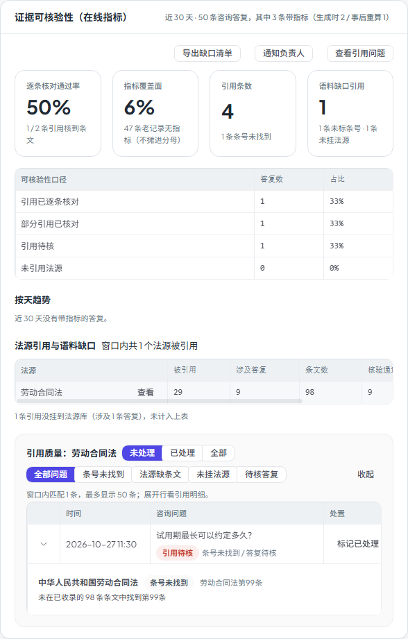

# 第五十二步交付说明：引用问题处置（标记已处理 / 导出缺口 / 批量通知）

> 一句话：step51 的引用问题清单只能看，这一轮补上三个动作——每条咨询可「标记已处理 / 重新打开」；语料缺口可导出 CSV（全量零条文法源，不截 top 10）；未处理问题可按组织批量通知管理员（站内 + 可用邮件，每日幂等）。

- 日期：2026-10-28
- 后端：新表 `consultation_evidence_issue_marks`（迁移 `20261027_0112`）、`consultation_evidence.py`（处置/导出/通知）、`analytics_api.py`（4 个接口）
- 前端：`SystemExperimentsTab.vue`（状态筛选、处置列、导出/通知按钮）、`analytics.js`
- 测试：`tests/test_consultation_evidence_issues.py`（7，含处置/导出/通知幂等）、e2e `system-experiments-issues.spec.js`
- 截图：`step51-evidence-issues.png`（同一张卡片，已包含新按钮与处置列）

---

## 1. 标记已处理 / 重新打开

新表 `consultation_evidence_issue_marks`（一条咨询一行，唯一约束）：

| 列 | 含义 |
| --- | --- |
| `consultation_id` | 咨询 id（唯一，级联删除） |
| `organization_id` | 所属组织（组织管理员只能处理本组织） |
| `status` | `resolved` / `open` |
| `resolved_by` / `resolved_at` | 处理人与时间 |
| `note` | 处置备注（API 可选，最多 500 字） |

接口：

```http
POST /api/analytics/consultations/evidence-issues/{id}/resolve
POST /api/analytics/consultations/evidence-issues/{id}/reopen
```

- 列表默认 `status=open`，只显示未处理；可切 `resolved` / `all`；
- 已处理行显示「已处理 · 处理人」与「重新打开」；
- 重新打开删除标记，问题回到未处理清单；
- 组织管理员只能处理本组织咨询（平台管理员不限），越权/不存在分别 400/404。

## 2. 导出语料缺口清单

```http
GET /api/analytics/consultations/evidence-issues/export?days=30
```

- CSV（UTF-8 BOM，Excel 直接打开不乱码），列：法源ID、法源标题、引用标识、引用次数、涉及答复、核验通过、缺条文引用、已收录条文数；
- **全量零条文法源**，不是证据卡里 top 10 的子集；带组织过滤；
- 文件名 `citation-corpus-gaps-YYYYMMDD.csv`，浏览器下载。

## 3. 批量通知

```http
POST /api/analytics/consultations/evidence-issues/notify?days=30&issue=...&source_id=...
```

- 按未处理问题所属组织分组，通知该组织的 `role=admin` 账号；
- 站内始终创建，邮件仅在组织配置了可用外发策略时追加；
- `business_version=当天日期` + `template_key=citation_quality_issue`，同一天重复点击不会重复发；
- 单次最多归纳 100 条问题（列表上限），返回 `unresolved_total / notified_items / orgs / users / events / failed`；
- 前端按钮「通知负责人」，成功后提示「已通知 N 位管理员（M 条未处理问题）」；有面板筛选时按当前问题类型/法源收窄。

## 4. 前端

- 证据卡按钮：`导出缺口清单` `通知负责人` `查看引用问题`；
- 清单头部两排筛选：
  - 处置状态：未处理 / 已处理 / 全部；
  - 问题类型：全部 / 条号未找到 / 法源缺条文 / 未挂法源 / 待核答复；
- 表格压成三列（时间 / 咨询问题含等级与问题标签 / 处置），窄卡片里也能看到「标记已处理」按钮；
- 展开行仍显示引用明细。



## 5. 验证

| 项 | 结果 |
| --- | --- |
| 标记处理 | 默认清单不再出现；`status=resolved` 能看到处理人/备注；`status=all` 两条都出现 |
| 重新打开 | 标记删除，问题回到默认清单 |
| 越权/不存在 | 别组织管理员 → 400「无权」；不存在 → 404 |
| CSV | 含 BOM、表头与两个零条文法源；有条文的法源不出现 |
| 通知 | 只通知组织管理员；同一天第二次点击事件数不增加（幂等） |
| e2e | 1 passed（1.8s，全 mock）：导出下载、通知请求、标记处理→已处理视图→重新打开、问题过滤、法源下钻、展开明细 |
| 单测 | 处置/导出一组 7 passed；证据统计回归 17 passed |
| 门禁 | 见 §6（本树跑完回填） |

## 6. 门禁

- `scripts/check_all.py`：**10/10，11.4 分钟，exit 0**（本树最终状态；后端 2457 passed / 4 skipped）。
- 包体：总资产 **1699.3 / 1700 KB（99.96%，余 0.7 KB）**；OpenAPI 路径 **361**（新增 4 个接口）；前端单测 **96 passed**。

## 7. 边界

1. **按咨询整体标记**：一条答复同时有「条号未找到 + 待核」时，标记处理会一起清掉，不能只处理其中一个问题类型。
2. **UI 不带备注**：API 支持 `note`，面板默认只标记不填备注；需要说明时走 API/后续编辑。
3. **重新打开不留审计**：删除标记行，之前的处理人/时间不保留。
4. **导出只含零条文法源**：未挂法源（无 `source_id`）的引用不进 CSV；导出不做分页/上限，窗口内全量。
5. **通知只发组织管理员**：审核律师/普通成员不收到；平台管理员触发时按问题涉及的组织分别通知。
6. **单次最多 100 条**：超过 100 条未处理问题时，通知正文按前 100 条归纳；`unresolved_total` 仍返回真实总数。
7. **每日幂等**：同一天重复通知不会新增事件；第二天可再发。邮件渠道仍受组织外发策略约束。
8. **失败不重试**：单个管理员通知失败计入 `failed`，不阻塞其他组织；没有队列级重试。
9. **处置状态与问题分类解耦**：标记处理不改变 `evidence_json`/`references_json`，证据卡统计仍按原口径计数。
10. **迁移只建表**：不改咨询表、不回填历史；已有问题的默认状态就是「未处理」。

## 8. 回滚

- 代码：删除 4 个接口与前端按钮即可回到 step51 只读清单。
- 数据库：`alembic downgrade 20261027_0111` 删除处置标记表；不影响咨询与证据数据。
