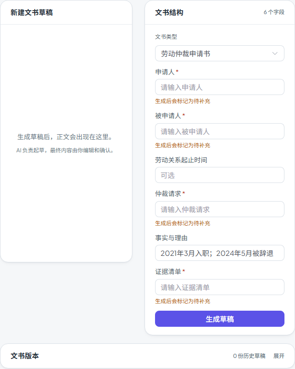

# 第五十五步交付说明：咨询结果带入文书/合同审查的挂载时序修复

> 一句话：从咨询结果点「生成文书」「进入合同审查」时，目标 tab 是异步组件，原来的 `prefill()` 在 ref 还不存在时调用，只弹了「已带入咨询案情」但字段是空的。现在先把内容记成 pending，等异步组件挂载、ref 出现后再应用；合同审查同时补上了真正可用的 `prefill`。

- 日期：2026-10-28
- 前端：`views/LegalWorkspace.vue`、`components/legal/LegalContractTab.vue`
- 测试：新增 e2e `workspace-prefill.spec.js`（1 passed）；门禁见 §5
- 无后端/数据库改动

---

## 1. 问题是什么

`LegalWorkspace.vue` 里：

```js
draftsTabRef.value?.prefill(type, fields)
setMatterTab('draft')
```

`draftsTabRef` 指向 `tab=draft` 的组件；点按钮时还在咨询 tab，draft 组件没挂载，ref 是 `null`，`prefill` 被静默跳过。随后切到文书 tab，字段仍是空的——但 `ElMessage.info('已带入咨询案情…')` 已经弹出。

step54 把三个主 tab 改成异步组件后，这个时序问题更容易暴露：即使 Vue 已经开始加载，ref 也要等异步组件解析完成才出现。

合同侧还有第二个问题：`LegalContractTab` 根本没有 `defineExpose({ prefill })`，所以 `contractsTabRef.value?.prefill(...)` 即使组件已挂载也是 no-op。

## 2. 改法

### 2.1 父组件：pending + ref watcher

```js
const pendingDraftPrefill = ref(null)
const pendingContractPrefill = ref(null)

const applyPendingDraftPrefill = () => {
  const target = draftsTabRef.value
  if (!target?.prefill || !pendingDraftPrefill.value) return
  target.prefill(pendingDraftPrefill.value.type, pendingDraftPrefill.value.fields)
  pendingDraftPrefill.value = null
}
```

- 点击时只记 `pending`，再 `setMatterTab('draft')`；
- `nextTick` 先试一次（组件已缓存时可能立刻可用）；
- `watch(draftsTabRef, applyPendingDraftPrefill, { flush: 'post' })` 在异步组件解析、ref 出现后补一次；
- 合同侧同样一套；
- 额外监听 `activeCaseTab`：如果用户没等加载就切走，清掉 pending，避免下次打开 tab 时突然出现旧案情。

### 2.2 合同审查：补 `prefill`

```js
const prefill = (title, content) => {
  startNewReview()
  contractForm.value = { title: title || '', content: content || '' }
}
defineExpose({ prefill })
```

- 先回到「新建审查」态，避免上一次审查结果盖住表单；
- 再填合同名称与合同原文（来自咨询 `known_facts` 的换行拼接）。

### 2.3 文书：沿用已有 `prefill`

`LegalDraftsTab` 原本就 `defineExpose({ prefill })`；现在只是确保它在组件 onMounted（模板字段已初始化）之后才被调用。

## 3. 用户看到什么

- 咨询结果卡点「生成文书」→ 文书 tab 的「文书类型」为对应类型（如劳动仲裁申请书），「事实与理由」填好咨询已知事实；
- 点「进入合同审查」→ 合同审查 tab 的「合同名称」为「劳动争议关联审查」之类，「合同原文」填好已知事实；
- 两个动作仍保留原来的提示文案，但这次字段真的带过去了。



## 4. 验证

新增 e2e `workspace-prefill.spec.js`（全 mock，1 passed / 1.5s）：

1. 进入案件咨询 tab，提交咨询，mock 返回 `category=labor_dispute`、`known_facts=[2021年3月入职, 2024年5月被辞退]`；
2. 点「生成文书」→ 断言 URL `tab=draft`；「劳动仲裁申请书」已选；`事实与理由` 输入框值等于 `2021年3月入职；2024年5月被辞退`；
3. 切回咨询 tab 重新提交，点「进入合同审查」→ 断言 URL `tab=contract`；合同名称等于「劳动争议关联审查」；合同原文等于两行事实；
4. 断言没有未处理的 API 请求、没有 4xx/5xx、没有运行时错误面板。

构建：

- 入口 80.3 / 100 KB；
- 最大页面 chunk 85.3 / 130 KB（SystemAnalyticsTabs）；
- 总资产 1679.3 / 1700 KB（余 20.7 KB）。

全量门禁见 §5。

## 5. 门禁

- `scripts/check_all.py`：**10/10，12.1 分钟，exit 0**（本树最终状态）。
- 后端全量：**2457 passed / 4 skipped**；OpenAPI **361**；前端单测 **96 passed**。
- 包体：入口 **80.3 / 100 KB**、最大页面 chunk **85.3 / 130 KB**、总资产 **1679.3 / 1700 KB**。

## 6. 边界

1. **只修 prefill 时序**：从咨询结果带入文书/合同审查的两条路径；其他 `refresh()` 调用仍是「组件在就调用、不在就跳过」，没有改成 pending。
2. **切走即丢弃**：点了「生成文书」但在组件挂载前切到别的 tab，pending 会被清掉，不会在下次打开文书时突然出现；用户需要重新从咨询结果点一次。
3. **带入的是事实，不是完整文书/合同**：文书只填「事实与理由」，其他必填字段仍要用户补；合同只填标题与原文（事实拼接），不是可审查的完整合同。
4. **不跨案件/刷新持久化**：pending 只在当前页面实例内；刷新后咨询结果卡本身也要从历史恢复，不会自动重放 prefill。
5. **合同 prefill 会重置当前审查**：如果已有审查结果，点「进入合同审查」会回到新建审查态并清空上一次结果；这是为了不让旧结果盖住带入内容。
6. **没有新增接口**：全部是前端状态与组件 expose，无后端改动。
7. **回滚**：删除 pending 与 watcher、恢复 `draftsTabRef.value?.prefill(...)`、移除合同 `defineExpose` 即可；会回到「提示已带入但字段为空」的旧行为。

## 7. 后续建议

- 如果还有其他「跳 tab 后立即调用子组件方法」的入口，可以复用这套 `pending + ref watcher`，不要再直接 `ref.value?.method()`；
- 包体余量 20.7 KB，下一步若继续做功能，先量产物；
- 咨询结果卡本身在切 tab 后会丢（组件本地 state），如果要做「咨询→文书→返回咨询结果」连续操作，应把 `consultResult` 提升到页面级或按 `consultation_id` 恢复——这是比 prefill 更大的体验缺口。
