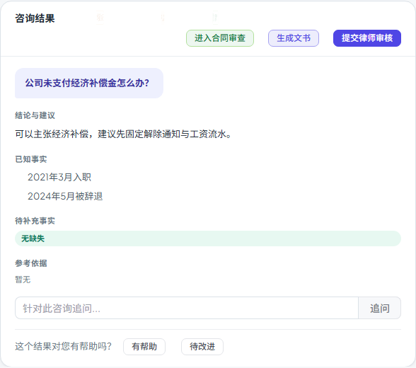

# 第五十六步交付说明：咨询结果提升到案件工作区页面级

> 一句话：`consultResult` 从 `LegalConsultationsTab` 的组件本地 state 提升到 `LegalWorkspace` 页面级 ref，通过 provide/inject 共享。切到文书/合同审查再切回咨询时，结果卡还在，不用重新提交一次；换案件时清空，避免跨案残留。

- 日期：2026-10-28
- 前端：`composables/consultationResultKey.js`（新增）、`composables/useLegalConsultations.js`、`views/LegalWorkspace.vue`、`components/legal/LegalConsultationsTab.vue`
- 测试：更新 `workspace-prefill.spec.js`（e2e 1 passed）
- 无后端/数据库改动

---

## 1. 问题是什么

`LegalConsultationsTab` 用 `v-if`/`v-else-if` 切换，离开咨询 tab 时组件卸载；`useLegalConsultations` 里的 `consultResult = ref(null)` 是组件本地 state，随之丢失。

后果：

- 从咨询点「生成文书」→ 切回咨询，结果卡没了，只能重新提交或去历史里找；
- 从咨询点「进入合同审查」→ 再回来，同样丢失；
- 用户在一次咨询里想“先看文书、再回来看结论”做不到。

step55 的 e2e 当时只能靠“重新提交一次咨询”来测合同带入，正是这个问题的证据。

## 2. 改法

### 2.1 注入键

新增 `composables/consultationResultKey.js`：

```js
export const CONSULT_RESULT_KEY = Symbol('legal-consultation-result')
```

### 2.2 父组件持有 ref

`LegalWorkspace.vue`：

```js
const consultResult = ref(null)
provide(CONSULT_RESULT_KEY, consultResult)
watch(currentCaseId, () => { consultResult.value = null })
```

- 页面级持有，咨询 tab 卸载不丢；
- 换案件（`currentCaseId` 变化）清空，避免把 A 案的结果带到 B 案；
- 离开工作区页面，父组件卸载，ref 自然释放。

### 2.3 子组件注入并交给 composable

`LegalConsultationsTab.vue`：

```js
const sharedConsultResult = inject(CONSULT_RESULT_KEY, null)
const { consultResult } = useLegalConsultations({
  ...,
  result: sharedConsultResult,
})
```

`useLegalConsultations.js`：

```js
export function useLegalConsultations({ ..., result = null }) {
  const consultResult = result || ref(null)
```

- 工作区内：用父组件 ref；
- 不在工作区/单测直接使用：没有注入就退回本地 ref，行为不变（CopilotDock 等调用方不受影响）。

## 3. 用户看到什么

- 咨询 → 生成文书 → 切回咨询：结果卡、结论、已知事实、引用、送审按钮都还在；
- 咨询 → 进入合同审查 → 切回咨询：同样保留；
- 换案件：咨询结果清空，不会串案；
- 提交新咨询/追问/打开历史结果：覆盖当前结果卡，与之前一致。



## 4. 验证

更新 `workspace-prefill.spec.js`：

1. 提交一次咨询（mock 计数 `consults=1`）；
2. 点「生成文书」，断言文书字段已带入；
3. 切回「法律咨询」——**不再重新提交**，断言结果卡文案仍在，`consults` 仍为 1；
4. 点「进入合同审查」，断言合同标题/原文已带入；
5. 无未处理 API、无 4xx/5xx、无运行时错误面板。

构建：

- 入口 80.3 / 100 KB；
- 最大页面 chunk 85.3 / 130 KB（SystemAnalyticsTabs）；
- 总资产 1679.0 / 1700 KB（余 21.0 KB）。

全量门禁见 §5。

## 5. 门禁

- `scripts/check_all.py`：**10/10，14.3 分钟，exit 0**（本树最终状态）。
- 后端全量：**2457 passed / 4 skipped**；OpenAPI **361**；前端单测 **96 passed**。
- 包体：入口 **80.3 / 100 KB**、最大页面 chunk **85.3 / 130 KB**、总资产 **1679.0 / 1700 KB**。

## 6. 边界

1. **页面实例级，不是全局 store**：只在当前 `LegalWorkspace` 实例内保留；刷新/直接关页后丢失。
2. **刷新恢复仍靠 `consultation_id`**：如果 URL 带 `consultation_id`，咨询 tab 挂载时仍会走 `openConsultationDetail` 恢复；没有 URL 焦点时结果卡为空。
3. **换案件清空**：`watch(currentCaseId)` 清空，避免跨案残留；同一案件内切 tab 保留。
4. **切到 `view=review` 再回来仍保留**：父组件未卸载、案件未变；如果产品希望离开案件上下文就清空，需要再监听 `view`/路由。
5. **不自动刷新**：结果卡是提交时的对象；服务端后续变化（如审核状态）不会在切回时自动重取，除非用户重新打开历史详情。
6. **CopilotDock 不共享**：右栏 copilot 仍用本地 state；本次只改案件工作区的咨询 tab。
7. **无接口变化**：只是状态归属调整，提交/追问/送审/详情接口都不变。
8. **回滚**：删除注入键与 provide/inject，`useLegalConsultations` 恢复 `ref(null)`，即可回到组件本地 state。

## 7. 后续建议

- 刷新/分享恢复：step57 已把结果 id 写进 URL，刷新或分享后按 `consultation_id` 走历史详情恢复；
- 包体余量 21.0 KB，下一步继续做功能前先量产物。
