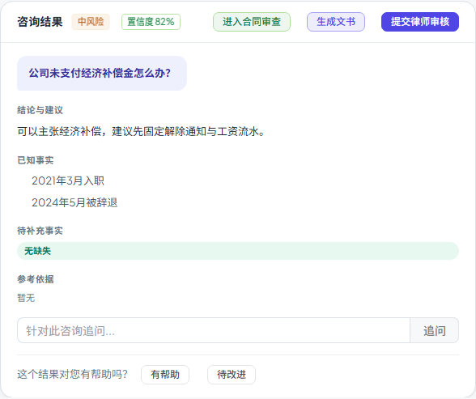

# 第五十七步交付说明：咨询结果写入 URL，刷新/分享可恢复

> 一句话：结果卡出现后把 `consultation_id` 写进 URL；刷新或分享链接时，页面级 ref 虽然为空，但咨询 tab 会按 URL 的 `consultation_id` 走历史详情恢复同一张结果卡。从文书/合同审查切回咨询时若页面级 ref 已有同一结果，则不再重复请求。

- 日期：2026-10-28
- 前端：`components/legal/LegalConsultationsTab.vue`、`tests/e2e/workspace-prefill.spec.js`
- 测试：e2e 1 passed（含刷新恢复）
- 无后端/数据库/API 变化

---

## 1. 问题是什么

step56 把 `consultResult` 提升到页面级，解决了「切 tab 后结果卡丢失」；但它仍是**页面实例内**的状态：

- 刷新页面 → 结果卡消失；
- 把链接发给同事 → 对方打开看不到这张结果；
- 从通知/记录深链进入时，只有 URL 带 `consultation_id` 才能恢复。

## 2. 改法

### 2.1 结果出现时写 URL

`LegalConsultationsTab.vue`：

```js
watch(() => consultResult.value?.id, (id) => {
  if (!id) return
  if (String(route.query.consultation_id || '') === String(id)) return
  router.replace({ query: { ...route.query, consultation_id: String(id) } })
})
```

- 提交咨询、追问、打开历史结果都会经过这里；
- 用 `router.replace`，不额外增加浏览器历史；
- 已有相同 id 时不重复 replace。

### 2.2 避免切回时重复请求

原来的 `initialConsultationId` watch 会在每次挂载时无条件 `openConsultationDetail(id)`。现在：

```js
watch(() => props.initialConsultationId, (id) => {
  if (id && consultResult.value?.id !== id) openConsultationDetail(id)
}, { immediate: true })
```

- 从文书/合同审查切回咨询：页面级 ref 已有同一 id，直接展示，不再打 `GET /legal/consultations/{id}`；
- 刷新/深链：页面级 ref 为空，才按 URL 拉详情恢复。

## 3. 用户看到什么

- 提交咨询后 URL 多出 `consultation_id=11`；
- 刷新后结果卡、结论、已知事实、引用、送审按钮都还在；
- 复制当前 URL 给同组织同事（有权限），对方打开能看到同一咨询结果；
- 从咨询去文书/合同审查再回来，不额外请求，结果卡仍在。



## 4. 验证

更新 `workspace-prefill.spec.js`：

1. 提交咨询 → 断言 URL 含 `consultation_id=11`；
2. 生成文书 → 切回咨询，结果卡仍在，`consults` 仍为 1；
3. `page.reload()` → mock 的 `GET /legal/consultations/11` 返回详情 → 断言结果卡文案仍在；
4. 从恢复后的结果卡点「进入合同审查」，合同标题/原文仍能带入；
5. 无未处理 API、无 4xx/5xx、无运行时错误面板。

构建：

- 入口 80.3 / 100 KB；
- 最大页面 chunk 85.3 / 130 KB（SystemAnalyticsTabs）；
- 总资产 1679.0 / 1700 KB（余 21.0 KB）。

全量门禁见 §5。

## 5. 门禁

- `scripts/check_all.py`：**10/10，12.2 分钟，exit 0**（本树最终状态）。
- 后端全量：**2457 passed / 4 skipped**；OpenAPI **361**；前端单测 **96 passed**。
- 包体：入口 **80.3 / 100 KB**、最大页面 chunk **85.3 / 130 KB**、总资产 **1679.0 / 1700 KB**。

## 6. 边界

1. **URL 是 `replace`**：不新增历史记录；浏览器后退不会在“无结果/有结果”之间来回跳。
2. **恢复仍受权限约束**：详情接口按组织/权限校验；无权或记录已删除时显示错误，结果卡为空。
3. **刷新拉的是服务端最新详情**：页面内保留的对象可能比服务端旧；刷新后会拿到最新状态（这是有意的）。
4. **分享需要同组织/有权限**：URL 只带 id，不带正文；对方打不开就是权限或记录不存在，不会泄露内容。
5. **结果切换会改 URL**：提交新咨询/追问/打开历史行都会把 `consultation_id` 换成当前 id；旧链接仍指向旧记录。
6. **不改变深链语义**：`consultation_id` 原本就是通知/案件记录的直达参数，这次只是让“正常提交”也写入它。
7. **失败时不写 URL**：提交失败没有结果 id，不会留下无效 `consultation_id`。
8. **无接口/数据库变化**：完全复用已有 `GET /legal/consultations/{id}`。

## 7. 后续建议

- 如果希望 URL 同时带 `case_id` 与 `tab` 的稳定分享（当前已有），可以在复制链接时统一补全；
- 包体余量 21.0 KB，下一步继续做功能前先量产物。
