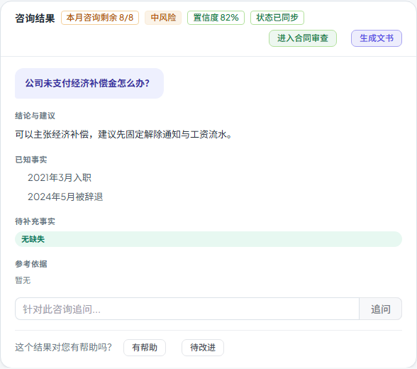

# 第五十八步交付说明：咨询结果与历史列表的状态一致性校验

> 一句话：结果卡保留在页面级 ref 后，可能停在提交时的状态；现在监听「结果 id + 历史列表」，发现列表里的状态比结果卡新时，按 id 重新拉一次详情，更新按钮并显示「状态已同步」。避免服务端已审核通过、页面还在显示「提交律师审核」。

- 日期：2026-10-28
- 前端：`components/legal/LegalConsultationsTab.vue`、`tests/e2e/workspace-prefill.spec.js`
- 测试：e2e 1 passed（含状态不一致场景）；门禁见 §5
- 无后端/数据库/API 变化

---

## 1. 问题是什么

step56/57 让结果卡跨 tab、跨刷新保留/恢复，但也带来一个旧状态问题：

- 页面级 `consultResult` 是提交时或上次打开时的对象；
- 从文书/合同审查切回咨询时，为了避免重复请求，step57 跳过了详情重取；
- 如果这期间审核律师已把咨询改成 `lawyer_approved`，历史列表已经是新状态，结果卡却还显示 `pending_review`，于是「提交律师审核」按钮仍然在。

刷新/URL 恢复会重新拉详情，所以问题主要出现在**同页切 tab 返回**和**列表已更新、结果对象没更新**的场景。

## 2. 改法

### 2.1 监听结果 id + 历史列表

```js
watch([() => consultResult.value?.id, consultations], () => { void syncResultStatus() }, { flush: 'post' })
```

`syncResultStatus()`：

```js
const row = consultations.value.find((item) => Number(item.id) === Number(result.id))
if (!row?.status || row.status === result.status) return
await openConsultationDetail(result.id)
statusSynced.value = true
```

- 只在 id 相同且**状态不同**时触发；
- 用 `statusSyncing` 防并发重复请求；
- 详情接口是权威来源，拉回后结果卡、按钮、后续动作都按最新状态渲染；
- 同步成功后显示 `状态已同步` 标签，给用户一个可见的解释。

### 2.2 不改变已有加载路径

- 从文书/合同审查切回咨询且状态一致：仍然不发请求（step57 的优化保留）；
- URL 刷新/深链恢复：本来就拉详情，列表状态通常一致，不会再触发；
- 打开历史行、提交/追问：走原有逻辑，watch 只做兜底。

## 3. 用户看到什么

- 历史列表状态比结果卡新时，结果卡自动刷新；
- 结果卡头部出现「状态已同步」；
- 如果状态已变成「律师通过」，「提交律师审核」按钮消失；
- 带入文书/合同审查的案情不受影响。



## 4. 验证

更新 `workspace-prefill.spec.js`：

- mock 历史列表在提交后返回 `lawyer_approved`，而提交响应是 `pending_review`；
- 断言结果卡出现「状态已同步」；
- 断言「提交律师审核」按钮数量为 0；
- 继续断言「生成文书」「进入合同审查」的字段带入仍然有效；
- 刷新后详情返回 `lawyer_approved`，结果卡仍正常恢复；
- 无未处理 API、无 4xx/5xx、无运行时错误面板。

构建：

- 入口 80.3 / 100 KB；
- 最大页面 chunk 85.3 / 130 KB（SystemAnalyticsTabs）；
- 总资产 1679.5 / 1700 KB（余 20.5 KB）。

全量门禁见 §5。

## 5. 门禁

- `scripts/check_all.py`：**10/10，11.4 分钟，exit 0**（本树最终状态）。
- 后端全量：**2457 passed / 4 skipped**；OpenAPI **361**；前端单测 **96 passed**。
- 包体：入口 **80.3 / 100 KB**、最大页面 chunk **85.3 / 130 KB**、总资产 **1679.5 / 1700 KB**。

## 6. 边界

1. **只比较 `status`**：不比较正文、引用、置信度等字段；如果这些在服务端变了但状态没变，不会触发同步。
2. **列表本身可能旧**：如果历史列表接口比详情更旧，状态相同就不会重取；权威判断仍以详情为准。
3. **一次差异一次请求**：`statusSyncing` 防并发；如果详情拉回后仍与列表不一致，不会无限循环（watch 只看 id 与列表，不看状态）。
4. **同步失败**：详情接口报错时 `openConsultationDetail` 会 toast，`statusSynced` 不会置 true；结果卡保持原样。
5. **不轮询**：只在结果 id 或历史列表变化时检查；其他用户在你停留期间改状态，不会自动推过来。
6. **URL 恢复通常不触发**：恢复时详情已经是最新，列表一致；标签只在“页面级旧对象被列表纠正”时出现。
7. **按钮状态仍以详情为准**：同步后 `submitConsultForReview` 的可见条件直接读新 `consultResult.status`，不需要额外开关。
8. **无接口/数据库变化**：复用 `GET /legal/consultations/{id}` 与现有历史列表。

## 7. 后续建议

- 如果要把“正文/引用也可能变”纳入同步，可比较 `updated_at` 或版本号，而不是只比状态；
- 包体余量 20.5 KB，下一步继续做功能前先量产物。
