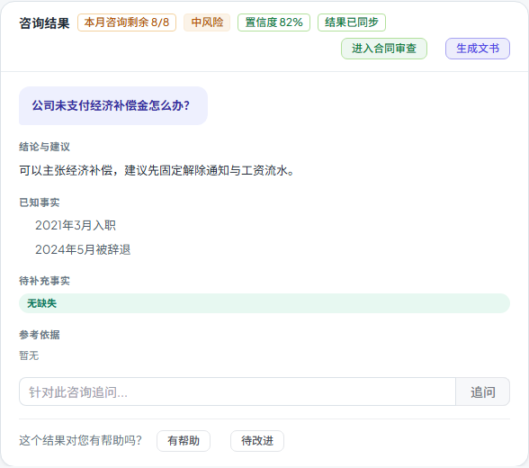

# 第五十九步交付说明：咨询结果同步条件扩展到 updated_at

> 一句话：step58 只在 `status` 不同时重取详情，正文、引用、置信度变了但状态没变就漏掉。现在同时比较 `updated_at`：列表更新时间比结果卡新，就按 id 重拉详情，标签从「状态已同步」改为更准确的「结果已同步」。

- 日期：2026-10-28
- 前端：`components/legal/LegalConsultationsTab.vue`、`tests/e2e/workspace-prefill.spec.js`
- 测试：e2e 1 passed（updated_at 触发场景）；门禁见 §5
- 无后端/数据库/API 变化

---

## 1. 问题是什么

step58 的一致性校验只看 `status`：

```js
if (!row?.status || row.status === result.status) return
```

但咨询详情里除了状态，还会变：

- 审核意见/答复正文；
- 引用与证据链；
- 置信度、风险等级；
- 追问后的新回答。

这些变化通常伴随 `updated_at` 更新，但 `status` 可能不变（例如仍在 `pending_review`，只是内容被修订）。只看状态就会继续显示旧结果卡。

## 2. 改法

`syncResultStatus()` 同时比较两个信号：

```js
const statusChanged = Boolean(row.status && row.status !== result.status)
const resultStamp = Date.parse(result.updated_at || '')
const rowStamp = Date.parse(row.updated_at || '')
const newer = Number.isFinite(rowStamp) && (!Number.isFinite(resultStamp) || rowStamp > resultStamp)
if (!statusChanged && !newer) return
```

- 状态不同 → 重取；
- 列表 `updated_at` 比结果卡新 → 重取；
- 结果卡没有 `updated_at`、列表有 → 视为更新（首次提交后的常见情况）；
- 时间戳解析失败 → 退回只比状态，不因坏格式反复请求；
- 成功后标签改为「结果已同步」，覆盖内容更新，不再只说状态。

## 3. 用户看到什么

- 审核意见/引用在服务端更新后，切回咨询或列表刷新会触发一次详情重取；
- 结果卡头部显示「结果已同步」；
- 旧按钮、旧正文、旧引用一起更新；
- 如果只是状态没变但内容没变，`updated_at` 相同，不会额外请求。



## 4. 验证

`workspace-prefill.spec.js` 把触发条件改成 **status 相同、updated_at 更新**：

- 提交响应 `status=pending_review`，没有 `updated_at`；
- 历史列表同 id 也是 `pending_review`，但 `updated_at=2026-10-28T12:00:00`；
- 详情接口返回 `lawyer_approved` + 同一 `updated_at`；
- 断言「结果已同步」出现；
- 断言「提交律师审核」按钮消失；
- 后续文书/合同审查带入、刷新恢复、无未处理 API 等断言保持。

构建：

- 入口 80.3 / 100 KB；
- 最大页面 chunk 85.3 / 130 KB（SystemAnalyticsTabs）；
- 总资产 1679.7 / 1700 KB（余 20.3 KB）。

全量门禁见 §5。

## 5. 门禁

- `scripts/check_all.py`：**10/10，14.1 分钟，exit 0**（本树最终状态）。
- 后端全量：**2457 passed / 4 skipped**；OpenAPI **361**；前端单测 **96 passed**。
- 包体：入口 **80.3 / 100 KB**、最大页面 chunk **85.3 / 130 KB**、总资产 **1679.7 / 1700 KB**。

## 6. 边界

1. **依赖后端下发 `updated_at`**：列表/详情都有该字段才有效；缺失时退回只比状态。
2. **只比较“列表比结果新”**：列表比结果旧不会触发，避免无意义请求；两边时间相同不触发。
3. **不比较具体字段**：正文/引用/置信度是否真的变了仍由详情接口返回；前端不做字段级 diff。
4. **时间戳解析失败**：`Date.parse` 无效时只按状态判断，不会因坏格式循环。
5. **仍不轮询**：只在结果 id 或历史列表变化时检查；停留期间别人改内容不会自动推。
6. **一次差异一次请求**：`statusSyncing` 防并发；详情拉回后即使列表仍显示更旧/更新，也不会在同一轮重复请求。
7. **标签文案变化**：从「状态已同步」改成「结果已同步」，因为现在可能只更新正文/引用。
8. **无接口/数据库变化**：复用现有列表与详情返回的 `updated_at`。

## 7. 后续建议

- 如果后端能提供 `version` 或 `content_hash`，用它替代时间戳更稳（不受时钟/格式影响）；
- 包体余量 20.3 KB，下一步继续做功能前先量产物。
