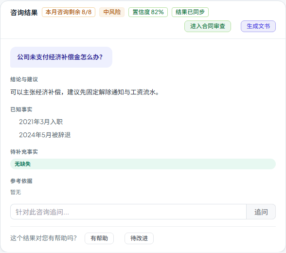

# 第六十步交付说明：咨询结果内容指纹 content_version

> 一句话：step59 前端用 `updated_at` 做一致性校验，但后端咨询 serializer 根本没下发这个字段——e2e mock 里有，真实接口没有，等于线上没生效。本轮补上 `updated_at`，并新增 `content_version`（内容指纹）：前端优先比指纹，缺失时才退回时间戳。

- 日期：2026-10-28
- 后端：`services/legal/legal_workspace_service.py`（`consultation_content_version`、serializer）
- 前端：`components/legal/LegalConsultationsTab.vue`、`tests/e2e/workspace-prefill.spec.js`
- 测试：`tests/test_consultation_evidence.py`（18 passed）；e2e 1 passed
- 无数据库迁移/接口路径变化

---

## 1. 发现的问题

step59 的前端逻辑：

```js
const rowStamp = Date.parse(row.updated_at || '')
```

但 `serialize_workspace_row()` 的咨询分支只返回 `created_at`，没有 `updated_at`——合同/文书分支有，咨询没有。列表与详情接口都走这个 serializer，所以：

- 真实接口的 `row.updated_at` 永远是 `undefined`；
- `Date.parse('')` 是 `NaN`，`newer` 永远 `false`；
- 只有 `status` 变化才会触发同步；
- e2e mock 手工加了 `updated_at`，把这个问题盖住了。

这是“测试数据比真实接口更完整”的典型盲区。

## 2. 改法

### 2.1 后端补 `updated_at` + 内容指纹

`consultation_content_version(row)`：

- 取 `question / category / advice / known_facts / missing_facts / references / risk_level / disclaimer_level / status / reviewer / review_note / reviewed_at / reviewed_version / parent_id / feedback_score / model_snapshot / attribution / faithfulness / evidence`；
- JSON 规范化后 sha256，取前 16 位；
- **不包含 `updated_at` 本身**，避免仅时间戳变化触发无意义重取。

咨询 serializer 增加：

```python
"updated_at": row.updated_at,
"content_version": consultation_content_version(row),
```

### 2.2 前端优先比指纹

```js
const versionChanged = Boolean(
  row.content_version && result.content_version && row.content_version !== result.content_version
)
const missingVersion = !row.content_version || !result.content_version
const newer = missingVersion && Number.isFinite(rowStamp) && (...)
if (!statusChanged && !versionChanged && !newer) return
```

- 两边都有指纹：只认指纹，不再看时间戳（避免时钟/精度问题）；
- 老记录没有指纹：退回 `updated_at`；
- 状态不同仍优先触发。

## 3. 用户看到什么

- 审核意见、引用、证据核验、置信度相关字段变化后，切回咨询会重取详情；
- 结果卡显示「结果已同步」；
- 同样内容不会因为 `updated_at` 刷新而多打一次请求；
- 真实接口现在终于能触发 step59 设计的同步。



## 4. 验证

后端新增 `test_serializer_exposes_content_version_and_updated_at`：

- serializer 返回 `updated_at`（包括 `None`）与 16 位 `content_version`；
- 同样内容指纹稳定；
- 改 `advice` 指纹变化；
- 再改 `status` 指纹继续变化。

e2e：

- 提交响应 `content_version=cv-old`；
- 历史列表同 id 为 `cv-new`（状态相同）；
- 详情返回 `cv-new` + `lawyer_approved`；
- 断言「结果已同步」、「提交律师审核」消失；
- 文书/合同审查带入、刷新恢复等原断言保持。

构建：

- 入口 80.3 / 100 KB；
- 最大页面 chunk 85.3 / 130 KB（SystemAnalyticsTabs）；
- 总资产 1679.8 / 1700 KB（余 20.2 KB）。

全量门禁见 §5。

## 5. 门禁

- `scripts/check_all.py`：**10/10，16.3 分钟，exit 0**（本树最终状态）。
- 后端全量：**2458 passed / 4 skipped**；OpenAPI **361**；前端单测 **96 passed**。
- 包体：入口 **80.3 / 100 KB**、最大页面 chunk **85.3 / 130 KB**、总资产 **1679.8 / 1700 KB**。

## 6. 边界

1. **指纹是读时计算**：不落库、不加迁移；每次列表/详情序列化都会算一次，咨询文本大时有少量 CPU 成本。
2. **16 位截断**：sha256 前 16 hex，碰撞概率对业务量可忽略，但不是密码学意义上的唯一版本号。
3. **字段范围有限**：只覆盖结果卡会用到的字段；`trace`、`review_due_at` 等不在指纹里，单独变化不会触发。
4. **列表和详情必须同一算法**：都走 `serialize_workspace_row`，不会出现两边指纹口径不一致。
5. **老记录没有指纹**：前端退回 `updated_at`；两者都没有时只比状态。
6. **状态优先**：状态变化即使指纹相同（理论上不会）也会触发。
7. **无接口路径变化**：只是响应多两个字段；OpenAPI schema 会随响应模型变化，但当前接口是自由 dict，路径数不变。
8. **前端仍不轮询**：只在结果 id 或历史列表变化时检查。

## 7. 后续建议

- 若以后要把指纹落库做增量同步，可加 `content_version` 列并在写路径更新；
- 包体余量 20.2 KB，下一步继续做功能前先量产物。
