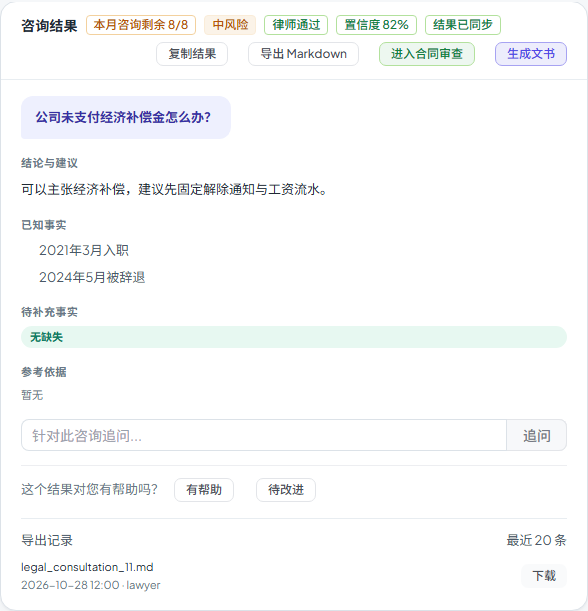

# 第六十三步交付说明：咨询导出记录与快照重下载

> 一句话：新增 `legal_consultation_exports` 表，每次导出把当时的 Markdown 快照落库；结果卡里的「导出记录」可展开看最近 20 条，并重新下载当时的快照。从“下载即失联”变成“可回看、可追责”。

- 日期：2026-10-28
- 后端：`models/legal.py`、迁移 `20261028_0113`、`api/legal/legal_api.py`
- 前端：`api/legalWorkspace.js`、`components/legal/LegalConsultationsTab.vue`
- 测试：后端 13 passed（导出/记录/下载/越权）；e2e 1 passed
- OpenAPI 路径 **364**（新增列表 + 下载）

---

## 1. 为什么补导出记录

step62 的 Markdown 导出是即时的：

- 响应结束就没了，只有一条审计日志；
- 用户关掉页面后无法重新下载同一份文件；
- 管理员也无法回答“这条咨询被谁导出过、导的是哪个版本”。

所以 step63 把“导出内容 + 元数据”落库，提供回看与重下载。

## 2. 数据表

`legal_consultation_exports`（迁移 `20261028_0113`）：

| 列 | 含义 |
| --- | --- |
| `consultation_id` | 咨询 id（级联删除，索引） |
| `organization_id` | 导出人组织（可空，平台管理员） |
| `user_id` | 导出人 |
| `format` | 目前固定 `markdown` |
| `filename` | 导出文件名 |
| `content_version` | 导出时的内容指纹 |
| `status_at_export` | 导出时状态 |
| `content` | Markdown 快照正文 |
| `created_at` | 导出时间（索引） |

- 存的是**快照正文**，不是“重新渲染当前内容”；
- 不接对象存储，Markdown 体积小，直接 `Text` 存储；
- 无清理任务，旧记录会一直保留（见边界）。

## 3. 接口

```http
GET /api/legal/consultations/{id}/exports?limit=20
GET /api/legal/consultations/exports/{export_id}/download
```

- 列表只返回元数据（id/文件名/格式/状态/指纹/时间/导出人），不返回正文；
- 下载先按 `export.consultation_id` 调 `get_row` 做权限校验，再返回快照；
- 两个接口都不泄露其他组织数据；越权/记录不存在统一 404；
- 导出接口现在会写一条 `legal_consultation_exports` 记录，并保留原审计；
- 重下载写 `legal_consultation_export_download` 审计，detail 带 `export_id`。

## 4. 前端

结果卡底部新增「导出记录」`<details>`：

- 展开才请求 `exports`，避免每次打开结果卡都打接口；
- 列表显示文件名、时间、导出人；
- 每行「下载」走快照接口，下载文件名用记录里的 filename；
- 导出成功后如果记录已展开，自动刷新列表。



## 5. 验证

后端 `tests/test_legal_workspace_case_sharing.py`：

- 案件成员导出 → 列表出现 1 条记录，且不含 `content` 字段；
- 用记录 id 重新下载 → 正文包含咨询问题；
- 外部组织成员下载 → 404。

原有 `tests/test_consultation_export.py` 3 条 Markdown 渲染测试继续通过。

e2e：

- 导出 Markdown 后展开「导出记录」；
- 断言文件名 `legal_consultation_11.md` 与导出人；
- 点「下载」，`waitForEvent('download')`，断言 `.md`；
- 原有复制、状态标签、带入、刷新恢复断言保持。

构建：

- 入口 80.6 / 100 KB；
- 最大页面 chunk 85.3 / 130 KB；
- 总资产 1684.0 / 1700 KB（余 16.0 KB）。

全量门禁见 §6。

## 6. 门禁

- `scripts/check_all.py`：**10/10，16.7 分钟，exit 0**（本树最终状态）。
- 后端全量：**2463 passed / 4 skipped**；OpenAPI **364**；前端单测 **96 passed**。
- 包体：入口 **80.6 / 100 KB**、最大页面 chunk **85.3 / 130 KB**、总资产 **1684.0 / 1700 KB**。

## 7. 边界

1. **快照存库**：每条导出都复制一份 Markdown，重复导出会产生多份正文；没有去重/压缩。
2. **无清理策略**：目前不自动删除旧记录，表会随导出次数增长；后续需要按组织/时间做保留策略。
3. **列表最多 50 条**：`limit` 上限 50，没做游标分页；导出非常频繁时旧记录看不到。
4. **不接对象存储**：Markdown 直接存 `Text`，适合小文本；如果以后导出 PDF/DOCX，应改对象存储。
5. **快照不可变**：重新下载不会反映服务端最新内容；要看最新请重新导出。
6. **权限跟随咨询**：能看咨询详情的人才能看导出记录/下载；导出人组织只作记录，不额外放开权限。
7. **下载文件名固定为记录里的 filename**：不随当前语言/状态变化。
8. **审计不含正文**：导出记录表有正文，审计日志只记动作与 id，避免重复存内容。
9. **无数据库回填**：step62 之前的导出没有记录，无法补。

## 8. 后续建议

- 给导出记录加保留策略（如 90 天/每咨询 20 条）与分页；
- 包体余量 16.0 KB，下一步继续做功能前先量产物。
