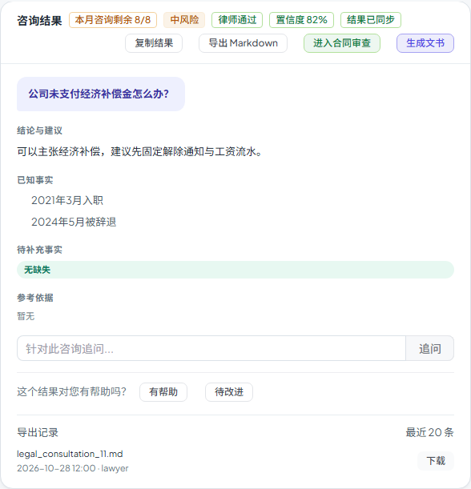

# 第六十四步交付说明：导出记录保留策略与分页

> 一句话：导出记录不再无限增长——每条咨询保留 **90 天 / 最多 20 份**，写入和列表时自动清理；列表改成 `id` 倒序 keyset 分页（`cursor` + `has_more`），前端「加载更多」按需取下一页。

- 日期：2026-10-29
- 后端：`services/legal/consultation_export.py`、`api/legal/legal_api.py`
- 前端：`components/legal/LegalConsultationsTab.vue`、`tests/e2e/workspace-prefill.spec.js`
- 测试：后端 15 passed（含保留/分页）；e2e 1 passed
- 无新迁移；OpenAPI 路径仍 **364**

---

## 1. 为什么补

step63 的导出记录有两个会随时间恶化的问题：

- **无清理**：每次导出存一份 Markdown，表只增不减；
- **无分页**：列表最多返回 50 条，再旧的记录永久看不到，前端也没有“加载更多”。

这一轮把“保留多久/保留多少”和“怎么翻页”定下来。

## 2. 保留策略

`consultation_export.py`：

```python
EXPORT_RETENTION_DAYS = 90
EXPORT_MAX_PER_CONSULTATION = 20
```

`prune_consultation_exports(db, consultation_id)`：

1. 删除 `created_at < now - 90 天` 的记录；
2. 按 id 倒序，保留最新 20 份，其余删除。

触发时机：

- **导出成功后**：先落库，再清理，避免本次导出把旧记录挤掉但自己没保存；
- **列表读取时**：顺手清理，用户隔很久再打开也能看到正确保留结果。

> 列表是 GET，但清理会写库；这是有意的保留策略副作用，失败不影响返回。

## 3. 分页

```http
GET /api/legal/consultations/{id}/exports?limit=20&cursor=301
```

- 按 `id desc` keyset 分页，`cursor` 是上一页最后一条 id；
- 多查一条判断 `has_more`；
- 返回：

```json
{
  "items": [],
  "next_cursor": 281,
  "has_more": true,
  "retention_days": 90,
  "max_records": 20
}
```

- `limit` 默认 20、上限 50；
- 响应从数组改为对象，前端同步调整。

## 4. 前端

「导出记录」：

- 展开时取第一页；
- 有 `has_more` 时显示「加载更多」，追加下一页；
- 摘要从「最近 20 条」改为「保留 90 天 · 最多 20 条」；
- 导出成功后如果记录已展开，重置回第一页刷新。



## 5. 验证

后端：

- 3 次导出、`limit=2`：第一页 2 条 + `has_more=true` + cursor；第二页 1 条 + `has_more=false`；
- 直接插入 25 条 + 1 条 120 天前的旧记录，列表触发清理后只剩 20 条，旧记录不在；
- 响应带 `retention_days=90`、`max_records=20`；
- 原导出/越权/下载断言保持。

e2e：

- mock 列表返回对象结构；
- 展开记录仍显示文件、时间、导出人；
- 下载快照仍成功；
- 原有复制、状态标签、带入、刷新恢复断言保持。

构建：

- 入口 80.6 / 100 KB；
- 最大页面 chunk 85.3 / 130 KB；
- 总资产 1684.4 / 1700 KB（余 15.6 KB）。

全量门禁见 §6。

## 6. 门禁

- `scripts/check_all.py`：**10/10，17.5 分钟，exit 0**（本树最终状态）。
- 后端全量：**2465 passed / 4 skipped**；OpenAPI **364**；前端单测 **96 passed**。
- 包体：入口 **80.6 / 100 KB**、最大页面 chunk **85.3 / 130 KB**、总资产 **1684.4 / 1700 KB**。

## 7. 边界

1. **清理靠写/读触发，不是定时任务（step64 当时）**：step65 已加 Celery beat 每日清理；写入/读取仍保留即时清理作为兜底。
2. **硬删除**：超出 90 天/20 份的记录直接删，没有归档/回收站；删了不能恢复。
3. **“最多 20 份”按 id 倒序**：同一秒内多条导出也按插入顺序保留最新，不按 `created_at` 精细排序。
4. **列表 GET 会写库**：清理是副作用；如果数据库只读/故障，读取会失败，不会返回旧列表。
5. **cursor 是 id**：不是时间游标；记录被清理后旧 cursor 仍可用（只是可能跳过已删记录）。
6. **无软删除/审计关联**：清理不写审计；导出审计仍在，但记录本身没了。
7. **保留策略是全局常量（step64 当时）**：step65 已进 settings，可由环境变量配置；仍不支持组织级。
8. **列表响应结构变化**：step63 的数组改为 `{items,next_cursor,has_more,...}`，前端已同步；外部调用方需要适配。

## 8. 后续建议

- 把保留策略做成可配置并加定时清理任务：step65 已完成 settings 配置 + Celery 每日任务；组织级仍待做；
- 包体余量 15.6 KB，下一步继续做功能前先量产物。
