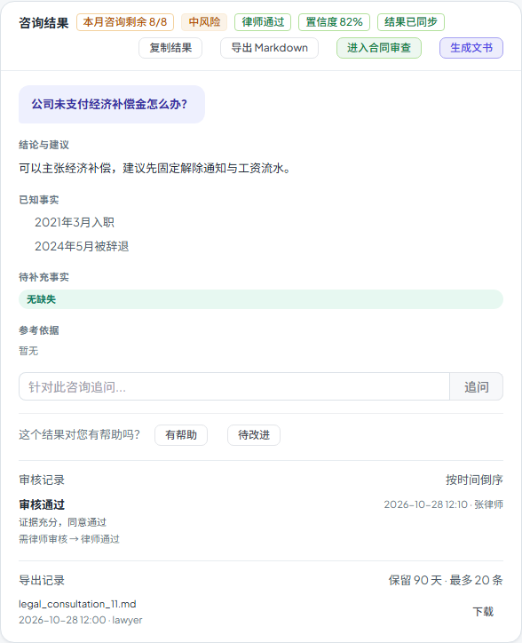

# 第六十六步交付说明：咨询结果卡展示审核记录

> 一句话：结果卡新增「审核记录」折叠区，展开后按时间倒序显示谁在什么时候做了什么（通过/退回/转线下/批注）、备注、状态变化。复用已有 `/legal/review-queue/consultation/{id}/history`，后端补上审核人姓名，前端按需加载。

- 日期：2026-10-29
- 后端：`services/legal/legal_workspace_service.py`（history 补 `reviewer_name`）
- 前端：`components/legal/LegalConsultationsTab.vue`、`tests/e2e/workspace-prefill.spec.js`
- 测试：`tests/test_legal_api.py` 补断言；e2e 1 passed
- 无迁移、无新接口路径

---

## 1. 为什么补

step58–61 之后结果卡能显示当前状态、能复制/导出，但用户看不到**过程**：

- 为什么状态从「待审核」变成「律师通过」？
- 是谁退回的、备注是什么？
- 转线下/批注发生过吗？

这些动作已经存在 `LegalReviewAction` 表里，审核台也有历史接口，但结果卡没有入口。补一个只读折叠区，成本低、对“可信过程”价值高。

## 2. 后端

`LegalWorkspaceReadModule.review_history` 原来只返回 action 行，没有审核人姓名。现在：

- 收集 `reviewer_id`；
- 一次 `User.id/username` 查询；
- 每条历史补 `reviewer_name`（用户被删时保持 `null`）。

响应仍是原结构 + 一个新字段，接口路径/权限不变。

## 3. 前端

结果卡底部新增「审核记录」`
`：

- 展开才请求 `getReviewHistory('consultation', id)`；
- 按时间倒序显示：
  - 动作：审核通过 / 退回补充 / 转线下 / 提交审核 / 批注；
  - 时间 + 审核人；
  - 备注；
  - `from_status → to_status`（中文标签）。
- 空时显示「还没有审核动作」；
- 加载失败显示后端 detail；
- 结果切换时清空并按需重载。

## 4. 验证

后端：

- `test_review_history_returns_actions_in_order` 增加断言：`reviewer_name == "legal_admin"`；
- 原有权限/顺序/备注断言保持。

e2e：

- mock 审核历史返回 `approve / 张律师 / 证据充分，同意通过 / needs_lawyer_review → lawyer_approved`；
- 展开「审核记录」；
- 断言「审核通过」「张律师」「证据充分，同意通过」；
- 导出记录、复制、状态同步、带入等原断言保持。

构建：

- 入口 80.6 / 100 KB；
- 最大页面 chunk 85.3 / 130 KB；
- 总资产 1686.7 / 1700 KB（余 13.3 KB）。

全量门禁见 §5。

## 5. 门禁

- `scripts/check_all.py`：**10/10，14.2 分钟，exit 0**（本树最终状态）。
- 后端全量：**2467 passed / 4 skipped**；OpenAPI **364**；前端单测 **96 passed**。
- 包体：入口 **80.6 / 100 KB**、最大页面 chunk **85.3 / 130 KB**、总资产 **1686.7 / 1700 KB**。

## 6. 边界

1. **只展示审核动作**：AI 生成、追问、证据回填等不会出现在这里；它们不是 `LegalReviewAction`。
2. **没有分页**：一次返回该咨询全部审核动作；动作极多时列表会很长。
3. **审核人可能为空**：用户被删除/历史数据缺 `reviewer_id` 时显示「审核人」。
4. **动作标签有限**：只映射 approve/return/offline/submit_review/comment，其他动作显示原始字符串。
5. **按需加载**：不展开不发请求；展开后切换结果会重新加载。
6. **权限沿用历史接口**：提交人本人或审核律师可见；其他人 403/404。
7. **只读**：不能在结果卡里通过/退回，仍要去审核台操作。
8. **无接口路径/迁移变化**：仅响应多 `reviewer_name` 字段。

## 7. 后续建议

- 给审核记录加分页或“只显示最近 20 条”；
- 若要把 AI 生成/追问也纳入过程，需要单独的事件表，不要硬塞进审核动作；
- 包体余量 13.3 KB，继续加前端功能前先量产物。
