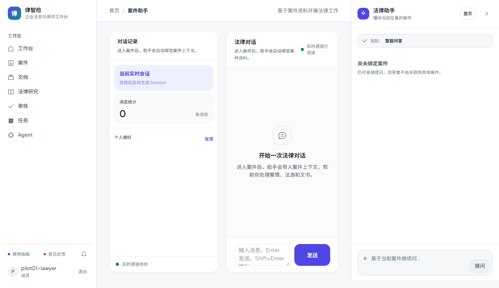

# 第七十步交付说明：移除 Tailwind，Chat 改语义 CSS

> 一句话：全仓唯一使用 Tailwind 工具类的是 `Chat.vue`，把它的模板改成语义类 + `design-tokens` 变量，删掉 Tailwind 入口、Vite 插件、两个依赖，并补一份最小 `reset.css` 替代 preflight。总资产 1689.1 → **1678.5 KB**，余量 10.9 → **21.5 KB**。

- 日期：2026-10-29
- 前端：`views/Chat.vue`、`styles/reset.css`、`main.js`、`vite.config.js`、`package.json`
- 测试：Chat e2e、工作台 e2e 均通过；门禁见 §5
- 无后端/接口/迁移变化

---

## 1. 为什么从 Tailwind 开刀

预算只剩 10.9 KB，先量了所有大头：

| 候选 | 结论 |
| --- | --- |
| Element Plus 图标 vendor（20.35 KB） | 大部分是 EP 组件内部在用，只换显式 16 枚只能省 ~2 KB，还会把 7 KB 路径塞进入口，不做 |
| el-table / el-card 等组件 | 全仓大量页面仍在用，删单个页面不减少总量 |
| 全局 CSS（100.8 KB） | 其中 Tailwind 入口占大头，而**唯一消费者只有 Chat.vue** |
| 拆异步 chunk | 只搬代码，总量通常还会涨 |

于是做真正能减总量的：**删掉 Tailwind**。

## 2. 改法

**Chat.vue**

- 模板从 `grid h-[calc(100vh-220px)] gap-5 text-sm text-slate-500 ...` 改为语义类：
  - `chat-page / chat-sidebar / chat-main / chat-messages / chat-bubble / chat-citations / chat-composer` 等；
- 颜色、间距、圆角、阴影全部走 `design-tokens.css` 变量；
- 去掉 `ui-card` 这个 Tailwind component 类，直接把卡片面写在 `.chat-sidebar/.chat-main`；
- 行为、WebSocket、引用跳转、偏好管理逻辑不变。

**reset.css**

Tailwind preflight 之前承担了全局 reset。删掉后补一份最小 reset：

- `box-sizing` / 标题与段落 margin / 列表 / 表单控件 / 按钮 / 链接 / 图片与表格；
- 只保留应用实际依赖的规则，约 1 KB；
- 在 `main.js` 里排在 `design-tokens.css` 之前。

**工程**

- 删除 `src/styles/tailwind.css`；
- `main.js` 删除 Tailwind 入口；
- `vite.config.js` 删除 `@tailwindcss/vite` 插件；
- `package.json` 移除 `tailwindcss`、`@tailwindcss/vite`（npm 卸掉 16 个包）。

## 3. 结果

| 指标 | 改前 | 改后 | 变化 |
| --- | --- | --- | --- |
| 总资产 raw | 1689.1 KB | **1678.5 KB** | **-10.6 KB** |
| 余量 | 10.9 KB | **21.5 KB** | +10.6 KB |
| 全局 CSS | 100.8 KB | 85.5 KB | -15.3 KB |
| Chat CSS | 3.4 KB | 9.3 KB | +5.9 KB |
| 入口 JS raw / gzip | 80.7 / 28.0 KB | 80.7 / 28.0 KB | 不变 |
| 最大页面 chunk | 85.3 KB | 85.3 KB | 不变 |

- 全局 CSS 降 15.3 KB，Chat 自己承担 9.3 KB，净省 10.6 KB；
- 入口没有变大；
- npm 依赖少 16 个（Tailwind 相关）。

## 4. 验证

- Chat e2e：WebSocket 发送 → 流式 chunk → done，通过；
- 工作台 e2e：咨询带入、结果卡、审核/导出记录、历史搜索，通过；
- 构建与包体：10/10 门禁见 §5；
- 人工检查 Chat 截图：两栏布局、消息区、引用卡、输入区均正常。

> 说明：本轮只对 Chat 与工作台做了 e2e/截图校验，没有逐页跑全部前端截图回归；reset 是 preflight 的最小等价集，仍建议后续页面改动时顺手看一眼。

## 5. 门禁

- `scripts/check_all.py`：**10/10，17.0 分钟，exit 0**（本树最终状态）。
- 后端全量：**2468 passed / 4 skipped**；OpenAPI **365**；前端单测 **96 passed**。
- 包体：入口 **80.7 / 100 KB**、最大页面 chunk **85.3 / 130 KB**、总资产 **1678.5 / 1700 KB**。

## 6. 边界

1. **reset 是手写最小集**：不保证覆盖 Tailwind preflight 的所有边角（如 `hr`、`abbr`、`fieldset`），遇到未覆盖的浏览器默认样式需补规则。
2. **不再有工具类**：后续新页面只能用 `design-tokens` 的 `.app-*` 语义类或 scoped CSS；不能写 `flex gap-2`。
3. **Chat 视觉是手工重写**：与旧版像素级一致性没有逐项比对，只做了截图与 e2e 功能校验。
4. **CSS 体积转移**：Chat 从 3.4 KB 增至 9.2 KB，但只在该路由加载；全局 CSS 对所有页面都减负。
5. **`color-mix` 已移除**：避免 Safari 15 不支持；全部用令牌纯色。
6. **依赖删除不可逆（对本轮）**：回滚需重新 `npm install` Tailwind 并恢复入口/插件。
7. **没有改预算红线**：1700 KB 不变，余量靠真实删代码换来的。
8. **Element Plus vendor 图标仍在**：`vendor-element-plus-icons-vue` 20.35 KB 主要是 EP 内部使用，本轮未动。

## 7. 后续建议

- 继续治理可从 Element Plus 按需样式/图标或 `el-table` 使用面入手，但收益/风险比不如本轮；
- 余量 21.5 KB，足够下一轮小功能，但仍建议先量产物；
- 若要做全站视觉回归，可补一组关键页面截图基线。
