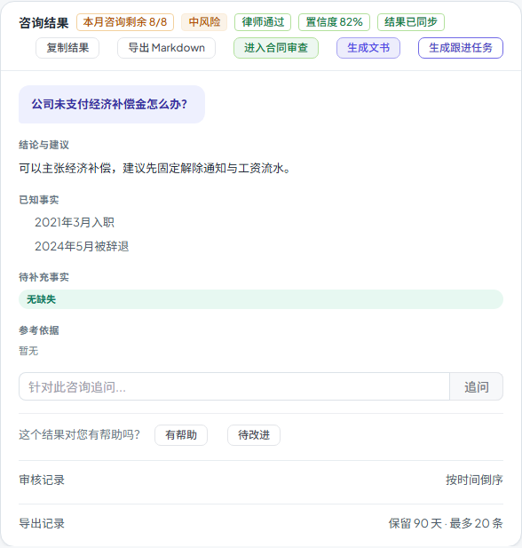

# 第七十八步交付说明：咨询结果生成跟进任务

> 一句话：咨询结果卡新增「生成跟进任务」，把问题、建议、当前状态写成一条 Task（`source_type=legal_consultation`、`source_id=咨询 id`）；同一用户对同一咨询重复点击只返回已有任务，不重复创建。

- 日期：2026-10-30
- 后端：`api/legal/legal_api.py`
- 前端：`api/legalWorkspace.js`、`components/legal/LegalConsultationsTab.vue`
- 测试：`tests/test_legal_workspace_case_sharing.py` +1；e2e 1 passed
- 无迁移；OpenAPI **370**（新增 1 条路径）

---

## 1. 为什么补

咨询结果目前能复制、导出、进入合同审查、生成文书、提交律师审核，但**没有把结论落成后续动作**：

- 律师看完建议后，下一步“跟进解除通知/工资流水”还得手工去任务页新建；
- 咨询与任务之间没有来源关联，事后无法追溯；
- 重复点击也不该产生多条重复任务。

## 2. 后端

```http
POST /api/legal/consultations/{id}/follow-up-task
```

- 先用 `get_row` 做咨询可见性校验（本人/案件成员/审核律师），越权 404；
- 同一用户 + 同一咨询已存在 `source_type=legal_consultation` 的任务时直接返回 `{created:false}`；
- 新建 Task：
  - `title`：`跟进咨询：{问题前 40 字}`；
  - `description`：咨询问题、咨询建议、当前状态；
  - `source_type=legal_consultation`、`source_id=咨询 id`；
  - `organization_id=当前用户组织`；
  - `priority=medium`；
- 写审计 `legal_consultation_create_task`，detail 带 `task_id`；
- 返回 `{id, title, created}`。

## 3. 前端

结果卡操作区新增「生成跟进任务」：

- 点击调接口；
- 成功提示「已生成跟进任务 #id」或「已存在跟进任务 #id」；
- 按钮带 loading，防连点；
- 失败显示后端 detail；
- 不改变原有复制/导出/送审/带入链路。



## 4. 验证

后端：

- 案件成员首次 POST → `created=true`；
- 第二次 POST → `created=false`，id 相同；
- 数据库只有 1 条 Task，`description` 含咨询问题；
- 外部组织 POST → 404。

e2e：

- mock `POST /legal/consultations/11/follow-up-task`；
- 点击「生成跟进任务」，断言请求计数为 1；
- 原复制、导出、审核记录、带入断言保持。

| 项 | 结果 |
| --- | --- |
| 后端单测 | 18 passed（共享/导出/任务） |
| e2e | 1 passed / 4.1s |
| 构建 | 入口 81.1 / 100；最大页面 chunk 85.3 / 130；总资产 **1684.8 / 1700**（余 15.2 KB） |
| 门禁 | 见 §5 |

## 5. 门禁

- `scripts/check_all.py`：**10/10，16.4 分钟，exit 0**（本树最终状态）。
- 后端全量：**2473 passed / 4 skipped**；OpenAPI **370**；前端单测 **96 passed**。
- 包体：入口 **81.1 / 100 KB**、最大页面 chunk **85.3 / 130 KB**、总资产 **1684.8 / 1700 KB**。

## 6. 边界

1. **幂等只看用户+咨询**：同一咨询不同用户会各自建任务；团队协作场景可能重复。
2. **不自动设置截止日期**：`due_date` 为空，需用户在任务页补。
3. **不写案件关联**：Task 模型没有 `case_id`，目前只通过 description/source 关联咨询；案件维度需要后续扩展。
4. **标题截断 40 字**：完整问题在 description 里。
5. **任务状态固定 todo**：不根据咨询状态自动流转。
6. **无外键**：`source_id` 只是普通字段，咨询删除后任务仍保留。
7. **生成后不自动跳转任务页**：只提示，避免打断阅读。
8. **无新表/迁移**：复用现有 Task。

## 7. 后续建议

- 给 Task 加 `case_id` 或元数据，支持案件任务视图；
- 支持在弹窗里填负责人/截止日期后再创建；
- 余量 15.2 KB，下一步继续量产物。
